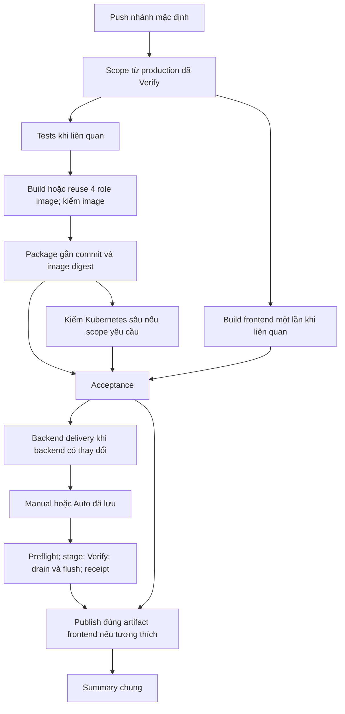

# CI/CD ứng dụng: một run, cập nhật theo thành phần

Source cải tạo ngày **10/11/2026**, Asia/Saigon. Đây là hợp đồng của source mới,
**chưa phải xác nhận đã phát hành hoặc nghiệm thu production**. Mode/chốt lỗi
phải đọc từ CD Control; không suy trạng thái live từ ngày cập nhật tài liệu.

## 1. Luồng thường ngày

Mở **01 Application Delivery**. Push vào nhánh mặc định tạo một run chứa kiểm
thử, image, backend delivery và Pages. Các file backend-deploy và
deploy-frontend-pages được gọi bằng `workflow_call`, hiển thị trong cùng run;
không có callback tạo thêm workflow trong đường phát hành thường.

Các mũi tên hội tụ vẫn chịu điều kiện: kiểm bắt buộc thất bại/skip thì không
deploy. Frontend-only bỏ nhánh backend và kiểm tương thích với backend đã
Verify; backend lỗi/deferred chặn frontend phụ thuộc. PR chỉ kiểm/build trên
hosted runner, không publish image hoặc chạy self-hosted deploy.

**Người vận hành:** push → xem run → duyệt nếu backend Manual → đọc Summary.
Runner Windows/Tailscale thực hiện chuỗi kubectl. Máy/runner/mạng/quyền cụm
vẫn phải sẵn sàng; xem [thiết lập RKE2](CICD_RKE2.md).

## 2. Scope và kiểm sâu

`pipeline.py scope` so **toàn bộ diff từ commit backend đã Verify**, không chỉ
push cuối; rename/delete giữ đường dẫn cũ. Frontend có publication record
riêng, so nội dung subtree và cấu hình API/base-path để quyết định build.
Thiếu/diverged baseline hoặc đường dẫn chưa biết ảnh hưởng chọn tất cả kiểm
nhanh. Mọi push đều không dựng kind, kể cả push sửa CI/CD; full chỉ manual/
lịch định kỳ, không phải điều kiện chặn phát hành thường ngày.

| Thay đổi tích lũy | Kiểm và phát hành |
| --- | --- |
| Frontend thuần | Frontend build/manifest, acceptance, kiểm backend tương thích, Pages |
| Tests hoặc docs thuần | Kiểm liên quan; không yêu cầu image/deploy app. docs/index.html là input API, không thuộc docs thuần |
| Hai script kiểm UI đã biết (Feature Importance/Training Monitor) | Regression, không tự yêu cầu backend/legacy; các rollout helper khác vẫn phân loại thận trọng |
| App/ML, manifest API/tree/neural hiện có, DAG cloud hoặc dependency role | Regression, package, 4 image checks; bỏ cụm thử Kubernetes; CD vẫn preflight/Verify/rollback |
| Engine/workflow/cache/schema/legacy/proof/harness hoặc deployment mới | Regression, package và image checks; không current/legacy trên push |
| Lịch sử/đầu vào không rõ | Tất cả kiểm nhanh gồm frontend và backend; không tự dựng kind |
| Lịch tuần hoặc Run workflow chọn validation=full | Full validation; không deploy production |
| Run workflow chọn validation=daily (mặc định) | Theo scope tích lũy như push; không deploy production |

Frontend upload giữ cả file ẩn trong `dist` (ví dụ `.nojekyll`) đúng manifest.
Frontend chạy `npm test` (Node test runner) trước `npm run build`.
Job `acceptance` chờ `frontend-build` kết thúc rồi tải artifact và kiểm đủ
file/hash/source/config/attempt trước khi chấp nhận bản phát hành. Không rebuild hoặc sửa manifest
để khớp một gói tải xuống bị thiếu file.

`Run workflow` có thể chọn nhánh thử nghiệm và validation=daily/full. Chọn
full hoặc lịch tuần chạy hai suite Kubernetes và build frontend dù nội dung
đã publish; daily chọn theo diff và publication hiện có. Image mới được publish
bằng content tag sau checks để cluster cô lập tải; backend/Pages production
vẫn chỉ được gọi khi push nhánh mặc định và qua toàn bộ gate hiện có.

Không sử dụng kết quả kiểm định kỳ của một commit khác làm proof ứng viên.
Current/migration giữ image thật, PostgreSQL/S3/flush và Kubernetes riêng;
HTTP business/Airflow REST là fixture. Giới hạn và ca kiểm ở
[tests/integration](../../tests/integration/README.md).

Người dùng chọn tách kiểm sâu khỏi mọi lượt phát hành để giảm thời gian chờ.
Khi cần kiểm startup/storage/lifecycle/rollback trên cụm tạm, chọn full rõ ràng;
không gắn lại điều kiện này vào push. CI không gọi Kaggle thật hoặc thay model
active; CD vẫn kiểm đúng gói, capacity, guard, preflight/Verify và phục hồi.

`acceptance` chạy kể cả dependency lỗi và kiểm mọi job bắt buộc theo scope.
Proof mới `traffic-application-acceptance/v1` gắn SHA/run/attempt, image bindings
và suite được yêu cầu. Proof legacy vẫn đọc được để phục hồi lịch sử; không
sửa/bỏ hash của proof cũ. Rerun phải dùng **Re-run all jobs**: artifact mới
ghi đè đúng tên trong cùng run, nhưng attempt cũ không được ghép với attempt mới.

Scope `traffic-application-scope/v3` tách lựa chọn full khỏi tác động của file:
push luôn daily; manual chọn full hoặc lịch tuần mới tạo cụm. Reader v1/v2
giữ chính sách cũ và không diễn giải lại proof đã phát hành thành coverage nhẹ
hơn. Scope v3 không được khai full cho push hoặc daily cho lịch kiểm định kỳ.

## 3. Build khác với deploy

| Thành phần | Điều kiện build/cập nhật |
| --- | --- |
| API/tree/neural/sync image | Reuse digest khi content source ID không đổi; build và kiểm image khi input đổi |
| API/tree/neural Deployment | Plan so desired spec đã server-default, gồm image/config/probe/resource/runtime contract; giống nhau thì giữ nguyên |
| Airflow | So source DAG/helper đã đóng gói, chỉ cập nhật scheduler khi đổi |
| Frontend | Một dist cùng manifest file/SHA/config/run/attempt; Pages không chạy npm build lần nữa |

Source ID gồm source/resource, dependency, base và recipe. Thư viện chung có
thể ảnh hưởng nhiều role. Hai worker hiện vẫn mang chung bundle ML/Kaggle;
không hứa sửa một file sẽ chỉ build một image trong mọi trường hợp.
Việc tách recipe/context sâu hơn là bước sau, không loại resource notebook
hoặc thư viện tải model lịch sử để làm hash ít thay đổi.

Summary image ghi Build/Reuse. Receipt/summary backend ghi từng component
Deploy/Keep và lý do. Kiểm trạng thái thành phần không có nghĩa restart nó.
Không apply lại PostgreSQL/MinIO/MLflow/PVC/Secret hay cả k8s/base trong release
ứng dụng. Live drift ngoài dự kiến bị chặn để xem xét.

## 4. Transaction backend và nhiều push

Manual dùng rke2-production có reviewer; Auto dùng rke2-production-auto. Công
tắc lâu dài ở [90 CD Control](CD_MODES.md), không đổi mode/chốt do gộp workflow.
Inspect trong run mới chấp nhận **chính run push đang chạy** sau khi các job
CI bắt buộc đã completed/success. Nó không giả run đã completed: gateway kiểm
đúng run ID/SHA/attempt/workflow/branch, acceptance và kết quả job thực.

Trên Windows: tải ZIP trọn vẹn → kiểm digest/CRC/manifest/binding → kiểm lại
nguồn/mode → claim → engine. Lỗi trước claim không giữ ownership giả. Giữ
kiểm ZIP thật và test Windows vì lỗi CD41 từng nằm tại ranh giới này.

CI có concurrency riêng cho tests/image/frontend/current/migration; job cũ
có thể bị hủy. CD có concurrency riêng cho **cả transaction**, không hủy khi
push mới. Ứng viên đã bị source mới thay thế được skip trước claim; kiểm lại
sau approval/tải gói. Completion order của CI không phải thứ tự phát hành.
Docs-only sau ứng viên không làm backend còn hợp lệ bị xem là source cũ.

Engine giữ blue/green hiện hữu: stage đúng role → Ready/warm/preview → chuyển
Service → Verify → drain/flush có ack → thu hồi bản cũ → trả DAG/nhả guard.
Placement hai API/tài nguyên/request dài/cache vẫn giữ. Rolling thuần hoặc
cửa sổ bảo trì cần phạm vi thiết kế riêng, không được ngầm bật trong gói này.

Training đang chạy thì defer **trước mutation**. 91 CD Retry chỉ thử Auto khi
không blocked/active và không có run ứng dụng/deploy khác đang chạy trên master.
Ngân sách tối đa **12 lần dispatch trong 6 giờ** từ khi lưu pending; hết budget
báo cần xem xét, không ép deploy hoặc xóa chốt. Nguồn bị thay thế được bỏ qua.
Đổi mode không ngắt transaction đã claim.

## 5. Restore-cache và lỗi

Preflight dùng chính source inventory của candidate sync trên sidecar hiện
có, chỉ list object metadata, không tải/xóa. Init restore dùng cùng hàm và tái
list khi pod bắt đầu. Kiểm trước stage API và kiểm lại sau admission; snapshot
preflight không bảo đảm bucket bất biến sau đó.

Source ứng viên dùng cache API **6GiB**, budget **20000 file / 80% của6GiB**.
Production chỉ đổi sau release Apply+Verify. Init dùng `active` mode: binary
model active/preprocessor được chọn từ DB read-only; metadata model và toàn
bộ năm prefix còn lại vẫn restore. Binary lịch sử tải khi cần qua serving
runtime. Preflight đọc mode từ chính manifest ứng viên, dùng cùng selection
và budget với init; thiếu artifact bắt buộc thì dừng. `full` mode vẫn có cho
các luồng dùng rõ chế độ đó, không tự fallback từ lỗi `active` sang `full`.

Tính bytes cộng dồn O(n); vượt budget dừng listing và ghi counts là **lower
bound**, không gọi đó là tổng inventory đầy đủ. Report thêm số binary model
đã bỏ qua; listing bị giới hạn100000object/60giây quan sát. Cache disk có
giới hạn, khóa giữa reader/uploader/flush và chỉ thu hồi bản sao đã bền vững;
không xóa model trên MinIO. Capacity tính thêm disk staging với reserve node,
không chỉ kiểm free disk tối thiểu. Chi tiết: [model cache](MODEL_ARTIFACT_CACHE.md).

| Lỗi | Hành vi |
| --- | --- |
| CI/acceptance lỗi | Không deploy ứng viên |
| Nguồn cũ trước claim | Skip, không tạo transaction hoặc failure latch mới |
| Package/preflight lỗi | Dừng, giữ bằng chứng; không chạy Apply để thử |
| Rollout/Verify/flush lỗi | Thu chứng cứ có giới hạn, rollback resource đúng ownership; workflow vẫn failed dù phục hồi thành công |
| Runner mất kết nối/receipt chưa đủ | Giữ ownership/chốt để phục hồi, không tự sửa state |
| Pages lỗi sau backend Verify | Backend giữ phiên bản đã Verify; retry artifact frontend, không tự rollback backend |

Receipt/chẩn đoán chỉ chứa facts đã lọc, giữ 30 ngày. Không upload env/spec thô,
private inverse, kubeconfig, Secret hoặc log provider thật. Trạng thái phục hồi
và deployment là hai kết quả riêng. [CD_MODES](CD_MODES.md) giữ hướng phục hồi.

## 6. Nguồn thiết kế và bằng chứng

Phép đo trước/sau, cách đọc artifact measurements và điều kiện thử ổn định:
[CI/CD benchmark](CICD_BENCHMARK.md). Summary chỉ thu metadata/receipt; thiếu
bằng chứng giữ unknown, không tính no-op/deferred là triển khai mới.

- [GitHub jobs/needs](https://docs.github.com/en/actions/how-tos/write-workflows/choose-what-workflows-do/use-jobs): điều kiện dependency failed/skipped và always.
- [Reusable workflows](https://docs.github.com/en/actions/how-tos/reuse-automations/reuse-workflows): inputs/outputs, context caller, environment và token permissions.
- [Concurrency](https://docs.github.com/en/actions/how-tos/write-workflows/choose-when-workflows-run/control-workflow-concurrency): giới hạn job/hàng chờ; không thay transaction ứng dụng.
- [Artifacts](https://docs.github.com/en/actions/tutorials/store-and-share-data), [upload-artifact](https://github.com/actions/upload-artifact/tree/v4): artifact bất biến, digest, overwrite khi rerun và cách bố trí path.
- [Docker test-before-push](https://docs.docker.com/build/ci/github-actions/test-before-push/): kiểm image thực trước publish.
- [S3 ListObjectsV2](https://docs.aws.amazon.com/AmazonS3/latest/API/API_ListObjectsV2.html): paginator metadata/size, không suy tổng từ một page.
- [Kubernetes Deployments](https://kubernetes.io/docs/concepts/workloads/controllers/deployment/): rollout/ready/rollback; tính tương thích training/cache vẫn thuộc ứng dụng.

Bằng chứng lịch sử CI #25 (546 test, current6/migration3, 28 phút56) và CD #37
no-op thuộc08/11, không phải timing của pipeline mới. Mức kiểm chứng/gói review
hiện hành xem [handoff phiên cải tạo](../../My-worklog/hand-offs/2026-11-10-cicd-simplification.md).
