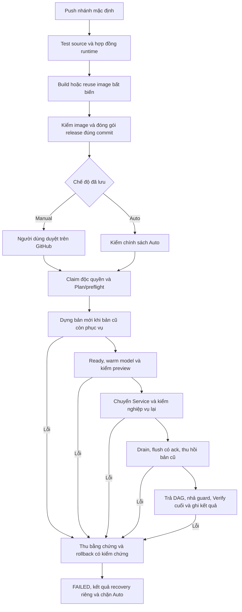

# Luồng CI/CD thống nhất

Ngày rà soát: **07/11/2026**, Asia/Saigon.
Trạng thái: **đã thực hiện source theo yêu cầu ngày07/11, đang kiểm chứng**.
Workflow/controller, manifest Git, hợp đồng flush và kiểm thử Kubernetes đã được
bổ sung. Chưa nghiệm thu production; CD vẫn tạm tắt trong quá trình kiểm thử.
Đợt chuyển runtime/đổi tên đầu tiên cần migration Manual được duyệt riêng.

## 1. Một quy trình phát hành

Giữ GitHub Actions, GHCR, runner Windows qua Tailscale và CD Control. Một engine
dùng chung cho Plan, Apply, Verify và Rollback. Manual/Auto chỉ khác cổng duyệt.

CI/build/đóng gói lỗi dừng trước deploy. Plan lỗi dừng trước mutation; training
đang chạy thì DEFERRED và giữ công việc/hàng chờ. Lỗi sau mutation phải xử lý
recovery; không tự replay Apply. Người dùng không chạy kubectl theo từng bản
cập nhật: runner gọi công cụ này trong engine. Vận hành khẩn cấp cũng dùng đúng
artifact/receipt và quy trình phục hồi, không tạo đường triển khai song song.

## 2. Khảo sát và quyết định giữ/thay

| Source đã đọc | Quyết định |
| --- | --- |
| backend-ci.yml: tests, bốn role image, offline model checks, artifact theo SHA | Giữ; chỉ build nội dung đổi, image reuse vẫn phải được kiểm. |
| backend-deploy.yml: provenance, gate theo mode, concurrency, claim, receipt/callback | Giữ khung, không tạo workflow deploy theo từng tính năng. |
| cd-control.yml, backend-deferred.yml | Giữ mode lâu dài/epoch, failure latch và retry riêng cho training bận. |
| deliver.ps1 chọn deploy.py/v1 hoặc roles_deploy.py/v2 | Là tương thích chuyển tiếp; sau migration chỉ một engine cho release thường ngày. |
| role_blueprints.py sinh template từ Deployment live | Chuyển cấu hình mong muốn sang manifest trong Git; live dùng để kiểm drift/identity và lưu inverse. |
| plan kiểm thay đổi chủ yếu bằng health/source image identity | Bổ sung so sánh manifest: probe/resource/config đổi cũng phải được triển khai dù image giữ nguyên. |
| drain_legacy gọi file nội bộ của sidecar cũ | Tách adapter migration có version; kiểm import/capability trước mutation. |
| Test hiện có chưa tái hiện Kubernetes migration toàn luồng | Thêm ca chạy đến flush/retire/rollback thực trên môi trường kiểm thử riêng. |
| Frontend CI và Pages build/publish độc lập | Đã thêm gate nội dung backend đã Verify và nội dung frontend hiện hành; chờ kiểm chứng CI. |

Lỗi exec đầu tiên còn thiếu bằng chứng. Hash thiếu server defaulting đã sửa;
adapter legacy đã kiểm chỉ đọc thành công trên hai API cũ ngày07/11, gồm đúng
loader/import hooks và uploader đã ghim hash. Điều đó chưa thay bằng chứng
nghiệm thu migration. Bộ CD mới chưa được coi là ổn định production.

## 3. Hợp đồng release và ranh giới thay đổi

Release ràng buộc commit đã kiểm, image digest từng role, manifest đã render,
config references và phiên bản giao thức runtime. Tiếp tục release.json và
delivery.json; schema không hiểu phải bị từ chối. Controller lấy từ đúng commit
được kiểm, không trộn code HEAD mới với một artifact cũ.

| Khi nâng cấp | Chỗ thay đổi thường ngày |
| --- | --- |
| Thêm/sửa/bỏ chức năng | Source và test của ứng dụng |
| Thêm/bớt/nâng thư viện | Dependency lock/recipe, build lại role và kiểm tương thích model |
| Đổi probe, tài nguyên, cấu hình hoặc thành phần | Manifest/role declaration trong Git và allowlist tài nguyên đã review |
| Đổi chính sách phát hành/hạ tầng/giao thức runtime | Thay CD có chủ đích, review và kiểm riêng |
| Đổi tên Deployment, image layout, schema DB hoặc định dạng artifact không tương thích | Kế hoạch migration có version, không nhét xử lý đặc biệt vào release thường ngày |

Tách image source ID khỏi deployment ID. Deployment ID phải bao gồm digest
image và manifest/config/giao thức liên quan. Cấu hình đổi không bị bỏ qua vì
image cũ; YAML chỉ đổi comment không tạo rollout. Secret chỉ có tham chiếu,
không có giá trị trong artifact. Thêm/bớt workload không cho phép prune cả
namespace hoặc cập nhật PostgreSQL/MinIO/MLflow/PVC ngoài phạm vi ứng dụng.

Health/lifecycle dùng hợp đồng có version: identity, serving-ready,
drain/status/resume và sync flush/ack. Giữ lifecycle HTTP API hiện có; sync cần
CLI/module công khai cố định, JSON kết quả và deadline (chưa thực hiện). CD gọi
giao thức này, không importlib vào file nội bộ từng image hay helper của một
tính năng. Flush phải xác nhận hoàn tất, không chỉ trả số file vừa upload.

Giữ UID/resourceVersion CAS và inverse private. Hash so sánh lấy từ cấu hình
đã server-default; drift ngoài phạm vi thì dừng, không force ghi đè/sửa receipt.
Manifest mong muốn trong Git thay việc sao chép cấu hình live; live vẫn là cơ
sở xác minh ownership và phục hồi đúng trạng thái trước mutation.

## 4. Chiến lược triển khai cố định cho topology hiện tại

Chọn **dựng nhóm dự phòng rồi chuyển Service** (blue/green), sử dụng các slot
cố định api/api-next, train-tree/tree-next, train-neural/neural-next. Slot không
dùng có replicas0, Service URL/NodePort giữ ổn định. Đây là một chiến lược dùng
lại, không đổi theo tính năng; chưa đưa Helm, Argo CD hoặc runner mới vào gói này.

Lý do: khảo sát06/11 ghi nhận hai API ở hai node với anti-affinity cứng. Chỉ
đặt maxSurge1/maxUnavailable0 cho cùng selector có thể khiến pod mới Pending.
Không nới placement hoặc hạ replica để làm workflow xanh. Kubernetes vẫn quản
lý Deployment, scheduling, probes và graceful shutdown; controller chỉ phối
hợp theo hợp đồng. Đổi sang rolling thuần về sau là việc hạ tầng riêng, không
xen vào cập nhật chức năng. Đây là lựa chọn của dự án, không phải giới hạn chung
của Kubernetes.

- Plan tính CPU/RAM requests, disk/cache và pod dư/Terminating. Thiếu capacity
  thì chưa triển khai. Chỉ stage role có deployment ID đổi; sync đổi kéo theo
  API chứa sync, DAG/control đổi mới cập nhật scheduler liên quan.
- Bản mới phải đủ replica Ready, warm model và qua preview rồi mới nhận traffic.
  Sau promote kiểm endpoint/nghiệp vụ lại; sau drain/flush có ack mới retire.
  Không ép kill request dài hoặc bỏ cache để làm pod Ready nhanh.
- Giữ admission riêng với serving; worker idle mới được thay, hàng chờ bền vững
  và hai DAG được trả đúng pause state. Không train/Activate/submit Kaggle thật
  để kiểm deployment.
- Cùng deployment ID và cấu hình đã xác minh là no-op, không restart/guard mới.
  Lỗi kết nối hoặc không thể kiểm identity phải được báo riêng, không suy thành
  khác phiên bản rồi rollout để thử.

## 5. Migration một lần, Manual/Auto và frontend

Chuyển bản cũ sang runtime chuẩn là **migration riêng chưa hoàn tất**. Tách nhận
biết layout cũ, bootstrap/đổi tên, flush legacy và inverse vào kế hoạch có
version/baseline rõ ràng. Engine thường ngày không tự chuyển layout không hiểu
hoặc chạy hook tùy ý từ metadata. Trước mutation, kiểm cả module/capability cũ
và mới, gồm uploader và DAG: lỗi đường dẫn vừa gặp phải dừng ngay tại đây.

Đợt chuyển đổi đầu cần Manual vì có chốt lỗi hiện hành. Sau nghiệm thu, release
thường ngày chỉ dùng runtime chuẩn. Adapter cũ giữ trong hồ sơ recovery đến hết
thời hạn hỗ trợ đã chốt, không gọi lại trong mọi release và không xóa sớm khả
năng phục hồi. Dependency tương thích vẫn được nâng qua cùng CI/image checks.

Công tắc Auto lưu qua nhiều push; Manual duyệt một lần cho một release. Đổi
mode không cắt transaction hoặc gỡ chốt. Mỗi namespace chỉ một transaction,
không để release cũ ghi đè bản mới hoặc hủy rollout giữa chừng vì push tiếp theo.
Retry chỉ cho DEFERRED theo policy. Rollback thành công vẫn ghi FAILED cho lượt
phát hành; mất lease/drift thì giữ ownership/chốt để phục hồi. Một Manual release
đạt kiểm chứng mới gỡ chốt Auto, không duyệt gate thay người dùng.

Summary/receipt ghi phase, workload/container, error type và HTTP status đã lọc,
kết quả deployment/recovery riêng. Phải thu được lỗi exec/flush dù pod đều Ready,
không chỉ thu khi CrashLoop. Không xuất token, response user, env/spec thô/inverse.

Frontend-only vẫn đi Pages với backend hiện hành tương thích. Khi frontend phụ
thuộc backend mới trong cùng gói, backend Apply+Verify đúng commit phải đạt
trước publish frontend artifact. Gate đã có trong source: so sánh Git subtree
với backend đã Verify, kiểm lại trước publish, ghi phiên bản thực đã publish
riêng với state CD. Backend đạt sẽ gọi lại Pages cho frontend mới nhất tương thích.
Công tắc Manual/Auto hiện có vẫn chỉ áp dụng cho backend.

## 6. Nghiệm thu trước khi phát hành lại

1. Hoàn thiện manifest trong Git, deployment ID và lifecycle/flush contract;
   sửa lỗi đã xác minh. Chưa thay production.
2. Kiểm toàn luồng trên Kubernetes tách biệt: source → image/artifact → preview
   → promote → flush/retire → Verify; dùng baseline image thực, DB/S3/Airflow
   fixtures và model tự sinh, không credential/dữ liệu/Kaggle production.
3. Bắt buộc kiểm: image cũ nhưng manifest đổi; no-op; path flush sai; server
   defaulting; startup/smoke lỗi; rollback trước/sau promote; drift/mất lease;
   training bận/hàng chờ; mode đổi giữa claim; runner mất kết nối; bằng chứng lỗi.
4. Chạy tải đọc trong suốt migration và cả retirement. Kiểm request dài, flush
   có ack và DAG/guard cuối; thiếu một bước thì chưa báo SUCCESS.
5. Khi user giao tiếp triển khai: đọc lại hiện trạng, review migration/Plan,
   mở CD theo policy và qua gate production. Thiết kế này không tự mở quyền đó.
6. Sau migration, kiểm một cập nhật ứng dụng tương thích và một no-op bằng cùng
   engine trước nghiệm thu; chỉ mở Auto lại khi được yêu cầu, không sửa code giả
   hoặc cố gây lỗi pod production để thử.

Mục tiêu là không có lỗi request hợp lệ do rollout và không mất công việc đã
nhận. Chưa kiểm chứng thì chưa tuyên bố đạt; quy trình không loại bỏ sự cố độc
lập ở ingress, mạng hoặc dịch vụ dữ liệu đơn lẻ.

## 7. Cách dùng sau khi đã nghiệm thu migration

1. Sửa source/test và manifest Git nếu cần đổi cấu hình. Push nhánh mặc định.
   Không thêm một workflow deploy riêng cho từng tính năng.
2. Backend CI phải đạt toàn bộ tests, image checks, package và
   `isolated-delivery`. Gói theo SHA giữ cả image digest và cấu hình mong muốn.
3. Khi CD được bật, `Deploy Backend RKE2` nhận gói đó. Manual yêu cầu duyệt
   environment; Auto giữ mode đã lưu qua nhiều push. Cả hai chọn operation
   `release` và đi cùng controller. Thiếu training idle thì DEFERRED, không
   cưỡng chế ngắt công việc để cập nhật.
4. Xem Summary để phân biệt deployment, recovery và bước frontend. Cấu hình
   giống bản đang chạy là no-op đã Verify; lỗi quan sát là lỗi riêng, không
   dùng restart để thử. Khi lỗi, gửi link Actions/receipt, không cần chụp kịp pod.
5. Chỉ sửa controller hoặc tăng runtime contract khi chính giao thức vận hành
   cần đổi; nâng cấp chức năng thông thường không đổi các bước phát hành.

Lần đầu từ legacy phải chọn `migrate-role-runtime-v1` trong workflow dispatch,
đúng CI thành công và qua Manual. Đây là chuyển runtime, không phải migration
dữ liệu ứng dụng. Artifact v1/controller cũ chỉ phục hồi transaction lịch sử;
không gửi vào engine mới. Trạng thái tạm dừng CD hiện tại không tự được mở lại
bằng commit tài liệu hoặc bật công tắc Auto.

Theo xác minh chỉ đọc sáng07/11, production vẫn là hai traffic-api và hai worker cũ;
DAG mở/guard nhả, CD_ENABLED=false, Manual/blocked=true/active=null. Đây là mốc
đã ghi nhận, chưa áp dụng controller mới lên production. Handoff tại
My-worklog/hand-offs/2026-11-05-system-optimization.md tiếp tục giữ điểm tiếp nhận.

Đối chiếu tài liệu chính thức:
[Deployment/rollout](https://kubernetes.io/docs/concepts/workloads/controllers/deployment/),
[placement/anti-affinity](https://kubernetes.io/docs/concepts/scheduling-eviction/assign-pod-node/),
[termination/preStop/sidecar](https://kubernetes.io/docs/concepts/workloads/pods/pod-lifecycle/).
