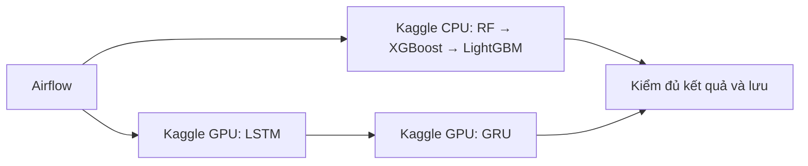

# Bản vá theo dõi Kaggle sau kiểm thử neural và bốn model

Ngày 28/10/2026, hai lượt lỗi đã được đọc journal:

- `3fe6918f-70c0-47c7-bf74-63122c1fbb56`: chọn LSTM+GRU. LSTM có output_verified;
  GRU lỗi **status/connect_timeout**, không phải thông báo lỗi phép fit hoặc hết GPU.
- `6a77efa4-973a-4258-b0b0-fe7ea4d895b3`: chọn ba cây+LSTM. Nhánh cây đã
  output_verified, LSTM có child_completed nhưng cũng lỗi **status/connect_timeout**.
  Vì chính sách cả lượt, tree bị hủy theo và không đăng ký kết quả của lượt lỗi.

Cả hai lượt đã dừng/dọn xong. Bỏ GRU không giải quyết được lỗi chung này.
“4/4 evaluated” chỉ xác nhận đánh giá, chưa bảo đảm đủ receipt và lưu thành công.

## Thay đổi

RPC SDK đọc status/source/metadata/output listing được thử lại tối đa ba lần
với **một ngân sách timeout chung**, chỉ khi lỗi mạng tạm thời/HTTP tạm thời.
Upload, submit notebook và delete không được gửi lại tự động bởi cơ chế này.
Quick Save bị mất phản hồi được đọc lại source chính xác để xác nhận, không
push lại. Poll status từ Airflow tới worker cũng retry có giới hạn, giữ nguyên
attempt/cursor. Hết ngân sách hoặc lỗi xác minh thật vẫn dừng toàn lượt.

Callback dừng lặp không ghi đè nguyên nhân đầu tiên, không đổi nhánh bỏ qua
thành Failed và không tạo hàng loạt dòng monitoring_timeout thứ cấp. Giữ
quy tắc dừng/dọn trước Dismiss và chặn đăng ký mọi output của lượt lỗi.

Không đổi thuật toán, CV, GPU placement, graph hoặc lựa chọn backend. Không
fallback Local hay tự fit lại. Đã kiểm mất một phản hồi status bằng fault
injection rồi đọc thành công qua SDK thật từ worker; chỉ có status/status,
không upload/fit/stop, không tốn thêm phiên GPU cho bài kiểm này.

## Chạy cả năm model hiện tại



Hai **nhóm** có thể hoạt động song song: cây trên CPU, neural trên GPU.
Trong nhánh neural vẫn LSTM rồi GRU, không phải năm notebook fit cùng lúc.
Kaggle có thể xếp hàng khi GPU chưa sẵn; thời điểm bắt đầu không được bảo đảm.
Xem [tài liệu Kaggle Notebooks](https://www.kaggle.com/docs/notebooks).

Giờ GPU giảm khi dùng phiên GPU là bình thường; nhánh cây không bật GPU.
Còn quota không bảo đảm một model đã hoàn tất; các lỗi ghi nhận ở đây là timeout
đọc trạng thái. Xem [hướng dẫn sử dụng GPU của Kaggle](https://www.kaggle.com/docs/efficient-gpu-usage).

## Áp dụng gói mới

Gói: `results/cloud-training/cloud-monitor-fix`.
Bundle: `bc425f79373fd30ac97f6173fe9a059e6dbc05353a71449aeca53978fefed707`.
Chạy từng lệnh từ `main_project`, chỉ sang bước tiếp khi bước trước đạt:

```powershell
powershell -NoProfile -ExecutionPolicy Bypass -File .\scripts\cloud_training\monitor-hotfix.ps1 -Action Check
powershell -NoProfile -ExecutionPolicy Bypass -File .\scripts\cloud_training\monitor-hotfix.ps1 -Action Apply
powershell -NoProfile -ExecutionPolicy Bypass -File .\scripts\cloud_training\monitor-hotfix.ps1 -Action Verify
```

Check chỉ đọc/server dry-run. Apply do user chạy: kiểm idle, pause DAG tạm,
rollout volume mã trên hai worker/API và hai Airflow pod, kiểm đủ replica rồi
trả pause về trạng thái cũ. Giữ flags cloud ON, image, migration và frontend.
Không cần publish frontend. Giữ `result-fix-journal.json` trong gói monitor nếu
Apply dở dang; có Rollback riêng khi không còn lượt đang chạy/chờ dừng. Không
replay Apply hoặc chạy lại Stage/Enable/gói vá cũ để vượt lỗi.

Sau Verify, thử lại **LSTM+GRU** trước; khi đạt hãy thử một lượt đủ năm model.
Mỗi lần một lượt, lưu UUID. Lỗi mới xem bằng `rollout.ps1 -Action InspectRun
-RunId 'UUID'`; kiểm bundle mới bằng **monitor-hotfix.ps1 -Action Verify**.
Các trường hợp tree-only, GRU-only, neural-only, đủ năm model và lỗi thật chặn
finalize đã được kiểm Airflow/XCom trên SQLite tạm riêng, không ghi DB dự án.
