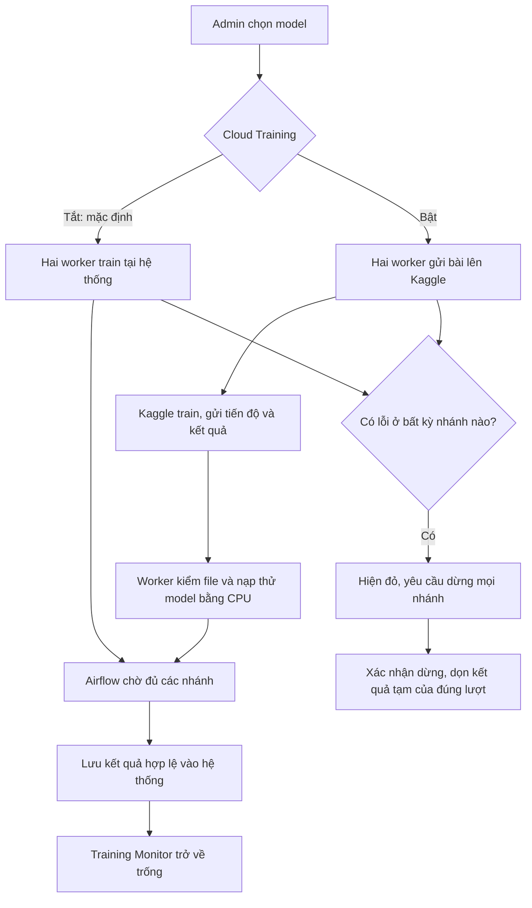

# Triển khai Cloud Training trên RKE2

Cập nhật 28/10/2026, giờ Việt Nam. Mã nguồn và gói review đã chuẩn bị;
**chưa áp dụng migration, rollout, bật cloud hoặc publish frontend**.
Người vận hành tự chạy các lệnh thay đổi hệ thống theo quy tắc dự án.

## Bắt đầu nhanh — bộ lệnh bàn giao cuối

Gói hiện hành là **`results/cloud-training/review-final`**. Gói này đã sửa lỗi
Airflow `DAG.description` chỉ đọc và được kiểm import trong pod Airflow thật.
Không dùng `review-ready` hoặc review-v1/v2/v3 của lần chuẩn bị trước.

Mở PowerShell tại `main_project`, chạy **từng lệnh** và chỉ sang lệnh kế tiếp
khi lệnh trước thành công:

```powershell
powershell -NoProfile -ExecutionPolicy Bypass -File .\scripts\cloud_training\rollout.ps1 -Action Preflight
powershell -NoProfile -ExecutionPolicy Bypass -File .\scripts\cloud_training\rollout.ps1 -Action Credentials
powershell -NoProfile -ExecutionPolicy Bypass -File .\scripts\cloud_training\rollout.ps1 -Action Stage
powershell -NoProfile -ExecutionPolicy Bypass -File .\scripts\cloud_training\rollout.ps1 -Action Enable
powershell -NoProfile -ExecutionPolicy Bypass -File .\scripts\cloud_training\rollout.ps1 -Action Verify -Expect enabled
```

`Credentials` đọc file token đã lưu ngoài dự án để tạo Secret nếu chưa có;
Secret có sẵn được giữ nguyên. Không cần nhập lại token. `Stage` vẫn tắt hai
cờ tính năng. `Enable` mới mở lựa chọn cloud; `Verify` chỉ đọc, kiểm **mọi
replica**, hash/graph DAG và DB head, không tự phát lệnh training.

Sau đó preview và publish frontend:

```powershell
powershell -NoProfile -ExecutionPolicy Bypass -File .\scripts\cloud_training\publish-frontend.ps1
powershell -NoProfile -ExecutionPolicy Bypass -File .\scripts\cloud_training\publish-frontend.ps1 -Publish
```

Lệnh đầu chỉ kiểm source/hash/HEAD/remote, không thay Git. Lệnh `-Publish` do
người dùng chạy sẽ kiểm lại cluster đã Enable và public API đúng bundle, rồi
commit/push **4 file frontend** đã review. Source backend đang sửa vẫn ở local.
Nếu đang stage công việc khác hoặc HEAD/source đã đổi, helper sẽ dừng để review
lại. Nếu push lỗi sau commit, giữ nguyên commit và đọc `frontend-publish.json`
trước khi xử lý; không chạy lại helper để tạo thêm commit.

Đợi workflow `Deploy Frontend To GitHub Pages` thành công, Ctrl+F5 và đăng nhập
admin. Workflow rebuild source đã push; kiểm API/base path trong log khớp
`frontend-build.json` đã chuẩn bị từ bundle Pages đang phục vụ. Gói ZIP frontend
local là bản review, không tự được GitHub Pages dùng. Phần hướng dẫn chi tiết
bên dưới vẫn có lệnh Python tương đương nếu cần chỉ định đường dẫn riêng.

Dữ liệu thử: `results/cloud-training/review-final/cloud-training-synthetic-5000.csv`.
Đây là 5.000 dòng tự sinh, đã qua validator CSV của ứng dụng, chưa upload/train.
Theo [kịch bản nghiệm thu](KAGGLE_TRAINING_ACCEPTANCE.md) để kiểm từng kết quả.

## Luồng sau khi bật tính năng



Airflow vẫn dùng graph cũ: validate → cây và LSTM song song → GRU sau LSTM
→ finalize. Worker cây vẫn ở node02, worker LSTM/GRU vẫn ở node03. Nhánh
không có model được chọn trả phiếu bỏ qua, không tạo notebook hoặc dùng GPU.
Worker gửi tiến độ thật vào trạng thái dùng chung; Airflow nhận tiến độ trong
task log, còn Training Monitor trình bày theo model, fold và epoch.

Switch chọn nơi train cho **cả lượt**; không tự chuyển Kaggle sang local khi lỗi.
Muốn thử lại local, admin tạo lượt mới với switch tắt. Auto retrain giữ luồng cũ;
đổi mặc định của auto retrain sang Kaggle là việc làm sau.

## 1. Những gì đã kiểm chứng

- 5 loại model đã chạy trên Kaggle bằng dữ liệu tự sinh: Random Forest,
  XGBoost, LightGBM, LSTM, GRU; CV 3 fold, neural dùng 1 epoch để kiểm đường chạy.
  Tree suite có chạy SHAP. Đây là kiểm tích hợp, không đánh giá chất lượng model.
- Model cây tốt nhất, LSTM và GRU tải về nạp/predict CPU trên worker hiện tại đạt.
- Supervisor đã phát tiến độ trong lúc chạy, gia hạn điều khiển và dừng tiến
  trình con ở cả CPU/GPU; các tài nguyên private của những bài thử đã dọn.
- Gói cuối khởi tạo được ở ba vai trò tree/recurrent/API, kể cả symlink của
  projected ConfigMap. Đây là tiến trình kiểm riêng, không khởi động background
  watcher hoặc thay tiến trình phục vụ hiện tại.
- UI thật đã kiểm desktop/mobile với API giả lập: switch, gửi lựa chọn Kaggle,
  tiến độ, lỗi đỏ, màn hình trống khi thành công và dismiss lỗi.
- 112 unittest, Vite build, compileall và kiểm whitespace đạt. Server dry-run
  chấp nhận cả ConfigMaps, migration Job và 5 deployment patches. Tại mốc
  19:26 ngày 28/10: không có Airflow/controlled run đang hoạt động, DB còn head
  cũ; Secret Kaggle trong cụm chưa có.

**Chưa nghiệm thu toàn luồng ứng dụng sau rollout**, nhất là khóa PostgreSQL
giữa pod, ghi kết quả MLflow/MinIO/registry và hoạt động qua frontend đã publish.
`production_ready:false` trong các proof vẫn đúng cho đến khi kiểm xong các bước đó.

Gói review hiện hành: `results/cloud-training/review-final`.
Bundle: `9462e5fd2e83b40d7354f23e5483e40ae88c6a93edd4fe80cbdf6a4579016a6c`.
Không dùng các thư mục review-ready/v1/v2/v3 cũ. Application bundle và SDK lock
không đổi nên giữ proof tương ứng; Airflow ConfigMap đã đổi và có proof import/
graph mới ràng buộc chính xác hash ConfigMap cuối.

## 2. Chuẩn bị cửa sổ PowerShell

Chạy từ thư mục gốc `main_project`, trong môi trường `.venv` đang dùng.
Trong lúc Stage/Enable/Rollback, không gửi thêm yêu cầu Train/Retrain.

```powershell
$cloudKubectl = 'C:\Users\ADMIN\AppData\Local\Programs\kubectl\kubectl.exe'
$env:KUBECONFIG = Join-Path $env:USERPROFILE '.kube\config'
$cloudReview = '.\results\cloud-training\review-final'
$cloudSnapshot = '.\results\cloud-training\snapshot-20261028-v2.json'
$cloudArgs = @('--kubectl', $cloudKubectl, '--review', $cloudReview, '--snapshot', $cloudSnapshot)
python .\scripts\cloud_training\manage_rollout.py @cloudArgs --action Preflight
```

Preflight chỉ đọc và server dry-run: đối chiếu UID/generation, hash DAG cũ,
DB head, worker rảnh và không có DAG run đang chạy/chờ. Nó kiểm cả manifest
ConfigMap, migration Job và 5 deployment patch trên API Kubernetes mà không
lưu thay đổi. `credential_secret_present:false` nghĩa là cần bước 3.
Nếu báo deployment thay đổi sau snapshot, dừng để tạo snapshot/gói review mới;
không sửa hash hoặc generation để vượt kiểm tra.

## 3. Đưa token vào Secret dành riêng cho worker

Tài khoản `truongphucdev` đã login trên máy này. Không nhập lại token vào chat.
Lệnh sau đọc trực tiếp file token ngoài dự án; không hiển thị giá trị token:

```powershell
$cloudTokenFile = Join-Path $env:USERPROFILE '.kaggle\access_token'
if (-not (Test-Path -LiteralPath $cloudTokenFile)) { throw 'Chưa tìm thấy file token Kaggle.' }
& $cloudKubectl -n traffic-mlops create secret generic traffic-kaggle-credentials --from-file="access_token=$cloudTokenFile"
if ($LASTEXITCODE -ne 0) { throw 'Secret chưa được tạo; kiểm tra trước khi tiếp tục.' }
```

Nếu Secret đã tồn tại, không chạy lại lệnh tạo hoặc in nội dung Secret.
Stage kiểm sự hiện diện; Enable sẽ kiểm xác thực từ chính credential được
mount trong từng worker. Token không được mount vào API/Airflow hoặc đưa vào
dataset/notebook Kaggle. Kaggle notebook dùng credential do nền tảng cấp.

## 4. Stage: đặt mã mới lên hệ thống, cờ vẫn tắt

```powershell
python .\scripts\cloud_training\manage_rollout.py @cloudArgs --action Stage
```

Helper tạm pause DAG, tạo hai ConfigMap bất biến, chạy migration thêm bảng
`training_executions`, rồi cập nhật lần lượt hai worker, API, Airflow webserver
và scheduler. Không đổi image, node, graph DAG, MinIO hoặc model active.
Mã mới vẫn gọi các lớp runtime/guard hiện có. SDK Kaggle nằm trong venv riêng
của worker, không cài đè môi trường ML đang phục vụ. Init container cần tải
dependency qua internet; nếu bước này lỗi thì chưa sang Enable.

Kết quả mong đợi: `staged:true`, `cloud_enabled:false` và bundle đúng ở trên.
DAG trở lại trạng thái pause ban đầu. API/worker vẫn dùng đường training cũ.
Migration thêm bảng và cập nhật head lên `20261028_01`; không sửa bản ghi model cũ.

Nếu Stage lỗi giữa chừng, giữ nguyên `rollout-journal.json`, xem bước đã đạt.
Không xóa journal hoặc chạy lại Stage để thử vận may. DAG có thể đang pause có
chủ đích để tránh chạy với cấu hình nửa cũ nửa mới; kiểm tra và dùng Rollback
ở mục 7 nếu cần. Không tự clear các task hoặc xóa dữ liệu để vượt kiểm tra.

## 5. Enable: mở điều khiển và lựa chọn cloud

```powershell
python .\scripts\cloud_training\manage_rollout.py @cloudArgs --action Enable
```

Chỉ chạy sau Stage đạt. Helper kiểm cả hai worker xác thực được Kaggle bằng
token đã mount, rồi bật `TRAINING_CONTROL_ENABLED` và `CLOUD_TRAINING_ENABLED`
trên worker/API. Mặc định trong modal vẫn local; không tự phát lệnh train.

Frontend cần được đưa lên bản mới bằng helper ở phần Bắt đầu nhanh để thấy
switch và Training Monitor. Có thể
kiểm thử local bằng `npm.cmd run dev` trong `frontend`, dùng cấu hình kết nối
API hiện hành. Khi publish Pages, người dùng review/commit/push các thay đổi
đã chọn và chạy workflow `Deploy Frontend To GitHub Pages` hiện có; giữ đúng
`VITE_API_BASE_URL`/`VITE_BASE_PATH` đang sử dụng. Workflow trên GitHub chỉ dùng
source đã push, không dùng `frontend/dist` local. Không chạy helper publish
SHAP cũ cho gói này vì nó ràng buộc source/hash của lần triển khai khác.

## 6. Dùng thử và nghiệm thu

1. Đăng nhập admin, chọn dataset thử được phép sử dụng. Tắt switch, chọn một
   model cây: xác nhận lượt mới báo Local và kết quả hợp lệ được lưu như trước.
2. Bật switch, chỉ chọn Random Forest: xác nhận Kaggle, chỉ nhánh cây tạo job,
   Training Monitor/Airflow có tiến độ thật; cuối lượt monitor trống.
3. Chọn LSTM hoặc GRU với cấu hình thử nhỏ; kiểm kết quả nạp được ở serving.
   Không dùng số liệu từ bài thử 1 epoch để kết luận model có chất lượng tốt.
4. Kiểm lỗi bằng bài thử cô lập được chuẩn bị riêng: bất kỳ nhánh nào lỗi thì
   cả lượt đỏ, sibling dừng, không đăng ký model từ lượt lỗi. Dataset đầu vào,
   model active và kết quả của lượt khác phải còn nguyên.

Tiêu chí hoàn tất: chỉ đăng ký sau khi đủ receipt đúng lượt và kiểm CPU đạt;
MLflow có kết quả trung tâm hợp lệ; không tự activate model; tài nguyên tạm
Kaggle/S3/local của lượt đã dọn; lỗi có thể Dismiss chỉ sau xác nhận dừng/dọn.
Nếu mất mạng, trạng thái đỏ/chờ xác nhận là đúng: không được coi mất kết nối
là đã dừng Kaggle. Cơ chế lease giúp notebook tự dừng khi không nhận gia hạn,
nhưng hệ thống vẫn phải đối chiếu trạng thái remote trước khi xác nhận.

Progress bar đếm số model đã đánh giá, không đoán số phút còn lại. Đạt đủ số
model chưa đồng nghĩa đã lưu xong; trạng thái finalizing vẫn có thể lỗi.
Thành công thì màn hình không giữ lịch sử. Lỗi giữ thông báo tối thiểu, không
giữ model/output lỗi; Dismiss chỉ ẩn thông báo đã xử lý xong.

## 7. Quay về runtime trước khi thêm tính năng

```powershell
python .\scripts\cloud_training\manage_rollout.py @cloudArgs --action Rollback
```

Chỉ rollback khi không còn lượt controlled đang chạy/chờ dừng. Helper kiểm
điều này trước khi thay deployment, khôi phục entrypoint/DAG/mount cũ và chỉ
gỡ phần được gói này thêm. Bảng bổ sung, token Secret và ConfigMap bất biến
được giữ; không chạy downgrade/xóa DB hoặc xóa model. Rollback không dừng
thay một job chưa xác nhận; xử lý job đó trước theo monitor và journal.

Nếu journal báo Stage chưa đầy đủ hoặc deployment đã được người khác sửa,
đọc tình trạng thực tế trước khi áp dụng. Không xóa toàn bộ thư mục/prefix
MinIO hoặc namespace để phục hồi.

## 8. Giới hạn hiện tại

Private snapshot đầu vào tối đa 100 MiB; output tối đa 128 file/1 GiB. Notebook
có thời hạn giám sát 8 giờ; không hứa GPU luôn sẵn hoặc hoàn thành đúng giờ.
Quota của tài khoản phải được kiểm lại khi sử dụng, không suy từ ảnh cũ.
Job cây dùng CPU Kaggle; neural yêu cầu GPU thật. Hết quota/lỗi là dừng lượt,
không tự chạy lại hoặc đổi nơi train. Máy local vẫn cần tài nguyên để đóng
gói, tải file, kiểm CPU, ghi kết quả và điều khiển.

Proof nằm trong `results/` và runtime triển khai trong `Deployment_test_on_rke2/`
đang theo ignore sẵn có. Không force-add hoặc sửa `.gitignore`; giữ gói review
trên máy vận hành để dùng các lệnh trên. Theo dõi tiếp ở
[hand-off Kaggle](../../My-worklog/hand-offs/2026-10-28-kaggle-training.md).
