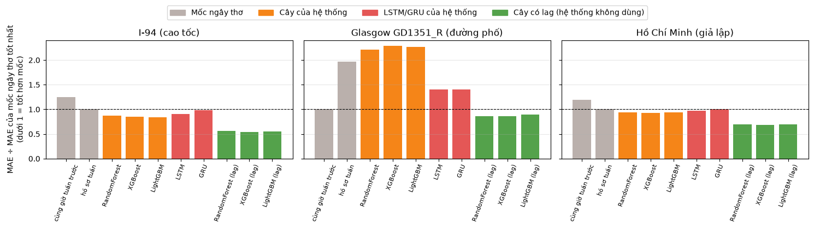
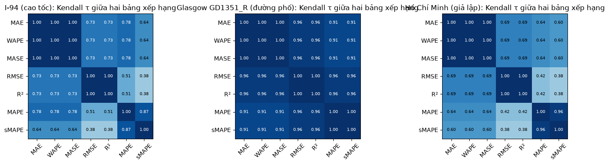
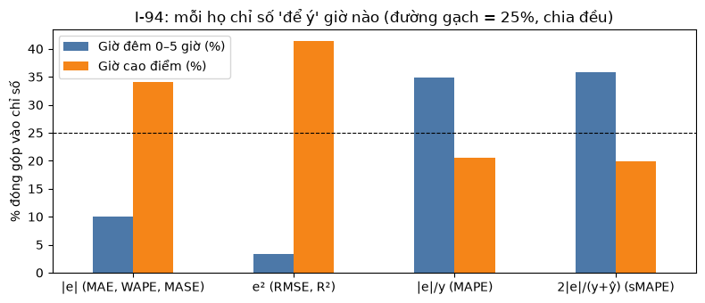

# E1 — Chỉ số nào đánh giá khả năng dự đoán tốt nhất?

> **Cập nhật:** 26/11/2026 · **Trạng thái:** đã chạy và đã kiểm (chờ người dùng xác nhận chỉ số chính).
> **Kết luận ngắn:** không có một chỉ số tốt nhất cho mọi việc. Với hệ thống này: **chọn model** nên giữ **MAE** (như hiện nay); **hiển thị cho admin** nên dùng **WAPE — "sai khoảng x% lưu lượng"** — kèm số xe sai và **so với cách đoán "cùng giờ tuần trước"**; **theo dõi để retrain** nên dùng họ MAE/WAPE (sẽ kiểm ở E3). Không dùng MAPE, sMAPE, R² làm chỉ số chính. Trên dữ liệu thật, cách hiển thị hiện tại (chỉ số xe tuyệt đối) che mất việc model ở Glasgow **kém hơn cả cách đoán đơn giản 40%** — đúng điều GVHD cảnh báo.

Notebook học từng bước (chạy lại được): [`notebooks/E1-chi-so-danh-gia.ipynb`](notebooks/E1-chi-so-danh-gia.ipynb) · Khung phương pháp: [`PHUONG-PHAP.md`](PHUONG-PHAP.md) · Hình: [`figures/`](figures/).

## 1. Vì sao cần thực nghiệm này

Hai ghi chú của GVHD:
- *"Nên đánh giá khả năng dự đoán của model bằng thông số nào là tốt nhất."*
- Tab **Model Quality** đang hiện **"Average difference"** (MAE, xe/giờ) và **"Difference"** từng giờ (sai số tuyệt đối): *"thấy chênh lệch ít thì tưởng dự đoán đúng, nhưng thực ra chênh lệch nhiều lắm"*; nên dùng RMSE/MAE để tính ra **tỉ lệ phần trăm**.

Hệ thống hiện tính 5 chỉ số khi train (MAE, RMSE, MAPE, WAPE, R² — `src/regression_metrics.py`), chọn model theo **MAE trung bình của kiểm tra chéo**, và tab Model Quality chỉ trả MAE, RMSE tuyệt đối.

## 2. Dữ liệu

| Dataset | Loại | Phần test dùng để so (giờ test chung của mọi model) | Số giờ | Lưu lượng TB |
| --- | --- | --- | --- | --- |
| I‑94 Minneapolis (`data/real/i94-minneapolis/`) | **Thật** (UCI), thời tiết ERA5 | 20/01/2018 – 30/09/2018 | 6.044 | ≈ 3.340 xe/giờ |
| Glasgow `GD1351_R` (`data/real/glasgow/`) | **Thật** (Zenodo), thời tiết ERA5, AQI CAMS | 17/02/2023 – 30/09/2023 | 4.783 | ≈ 250 xe/giờ |
| Hồ Chí Minh (`data/synthetic/`) | **Giả lập** (dataset đang chạy trên website) | 13/09/2025 – 31/12/2025 | 2.632 | ≈ 3.630 xe/giờ |

Cửa sổ train: I‑94 02/10/2012–01/10/2018; Glasgow 01/10/2019–01/10/2023 (có giai đoạn COVID); Hồ Chí Minh 01/01/2024–01/01/2026 (đúng lượt `f93d0351` của hệ thống). Phần test là 15% cuối, như cấu hình của website.

## 3. Cách làm

Theo khung 7 bước (`PHUONG-PHAP.md`), chia 5 bước nhỏ:

1. **Tính tay** 6 chỉ số trên 5 giờ thật (I‑94, 12/10/2016) và 3 thí nghiệm nhỏ: đổi quy mô, giờ 0 xe, một giờ sai nặng.
2. **Mốc so sánh ngây thơ:** 5 cách đoán không cần học máy (trung bình kỳ train, hồ sơ tuần = trung bình cùng thứ–cùng giờ, giờ trước, cùng giờ hôm qua, cùng giờ tuần trước); MASE theo FPP3 mục 5.8.
3. **Model thật của dự án**, train trên máy bằng **chính mã của dự án và đúng cấu hình website** (3 fold, 15% test, seed 42, 3 epoch). Ba nhóm: cây của hệ thống (`src.pipeline.run_pipeline`), LSTM/GRU của hệ thống (`train_region_recurrent_candidate`), cây có lag (`train_region_tree_lag_candidates`, có trong mã nhưng **hệ thống không dùng**). Đối chiếu với số hệ thống đã lưu. MLflow và SHAP tắt (không ảnh hưởng sai số).
4. **Chấm 7 chỉ số** bằng 4 phép thử: (A) thứ hạng, (B) so giữa các nơi, (C) độ vững khi lấy mẫu lại các ngày test 1.000 lần (bootstrap theo ngày, seed 0), (D) phần đóng góp của giờ đêm và giờ cao điểm.
5. **Quyết định** theo từng việc và minh họa trên dữ liệu thật.

**Ý nghĩa các chỉ số (lời thường):** MAE — trung bình mỗi giờ sai bao nhiêu xe; RMSE — như MAE nhưng phạt nặng lần sai lớn; WAPE — tổng số xe đoán sai chia tổng số xe thật; MAPE — trung bình % sai của từng giờ; sMAPE — % sai "đối xứng"; R² — tốt hơn cách đoán bằng trung bình bao nhiêu; MASE — MAE chia cho sai số của cách đoán "cùng giờ tuần trước" trên phần train.

## 4. Kết quả

### 4.1 Thí nghiệm trên máy giống hệ thống

| Model | CV MAE hệ thống | CV MAE trên máy | Test MAE hệ thống | Test MAE trên máy |
| --- | --- | --- | --- | --- |
| RandomForest | 341,5757 | **341,5757** | 306,9402 | **306,9402** |
| LightGBM | 346,1207 | **346,1207** | — | 307,7463 |
| XGBoost | 349,5603 | 350,1634 (lệch 0,17%) | — | 305,5820 |
| LSTM | 512,67 | **512,67** | 319,7594 | **319,7594** |
| GRU | 459,4409 | 458,643 (lệch 0,17%) | 328,4709 | **328,4709** |

Ba model trùng đến chữ số cuối, nên kết luận offline áp dụng được cho website. Hai chỗ lệch 0,17% có thể do phiên bản thư viện khác Kaggle (máy: xgboost 3.2.0, TensorFlow 2.21.0) — chưa kiểm.

### 4.2 Model so với mốc ngây thơ (MAE ÷ MAE của mốc tốt nhất; dưới 1 = tốt hơn mốc)

| Nhóm | I‑94 (thật) | Glasgow (thật) | Hồ Chí Minh (giả lập) |
| --- | --- | --- | --- |
| Mốc tốt nhất | Hồ sơ tuần, MAE 258 | Cùng giờ tuần trước, MAE 19,9 | Hồ sơ tuần, MAE 328 |
| Cây của hệ thống | 0,84–0,88 | **2,21–2,29** | 0,93–0,94 |
| LSTM / GRU của hệ thống | 0,91 / 0,98 | **1,40 / 1,40** | 0,98 / 1,00 |
| Cây có lag (hệ thống không dùng) | **0,54–0,56** | **0,86–0,90** | **0,68–0,70** |



- Ở **Glasgow (dữ liệu thật)**, cả 5 model hệ thống **kém hơn cách lấy số xe cùng giờ tuần trước**. Cây của hệ thống đoán thấp hơn thực tế trung bình 33 xe/giờ: không dùng số xe gần đây, nó chỉ đoán theo mức chung của phần train (có COVID).
- **Cây có lag** vượt mốc ở cả 3 dataset; so với cây của hệ thống, sai ít hơn 34–37% (I‑94) và 60–62% (Glasgow).
- Chỉ thử trên dữ liệu giả lập (Hồ Chí Minh) sẽ không thấy điểm yếu này.

### 4.3 Chấm 7 chỉ số

**A. Thứ hạng.** Trên cùng một dataset, **MAE, WAPE, MASE xếp hạng y hệt nhau** (Kendall τ = 1,00) và **RMSE, R² y hệt nhau** — 7 chỉ số thực chất là **3 họ**: \|e\| (MAE, WAPE, MASE), e² (RMSE, R²), phần trăm từng giờ (MAPE, sMAPE). Giữa các họ, thứ hạng có thể khác (τ thấp nhất 0,38 ở I‑94); ví dụ LSTM hạng 7 theo MAE nhưng hạng 4 theo RMSE. **3 cây có lag luôn hạng 1–3 theo mọi chỉ số.**



**B. So giữa các nơi** (LightGBM của hệ thống; cây có lag tốt nhất):

| | I‑94 | Hồ Chí Minh | Glasgow |
| --- | --- | --- | --- |
| MAE (xe/giờ) | 216 · 139 | 308 · 224 | 45 · 17 |
| **WAPE (%)** | **6,4 · 4,1** | **8,5 · 6,2** | **18,0 · 6,8** |
| R² | 0,970 · 0,988 | 0,953 · 0,972 | 0,503 · 0,922 |
| MAPE (%) | 9,7 · 6,0 | 10,9 · 8,0 | 19,7 · 7,7 |

MAE nhỏ nhất ở Glasgow nhưng đó là nơi model tệ nhất; WAPE cho cùng một ý nghĩa ở mọi nơi. R² phụ thuộc độ dao động của dữ liệu (ở cao tốc, cách đoán tuần trước cũng đạt ≈ 0,90).

**C. Độ vững** — tỉ lệ lần model thắng vẫn thắng khi lấy mẫu lại các ngày test (1.000 lần):

| Họ | I‑94 | Glasgow | Hồ Chí Minh |
| --- | --- | --- | --- |
| \|e\| (MAE, WAPE, MASE) | **99,9%** | 75,1% | **97,8%** |
| e² (RMSE, R²) | 86,6% | **100%** | 95,3% |
| MAPE | 92,5% | 75,0% (chọn model khác) | 73,8% (chọn model khác) |
| sMAPE | 82,1% | 79,4% (chọn model khác) | 88,2% (chọn model khác) |

Ở Glasgow, 3 cây có lag sát nhau (MAE 17,1–17,8) nên ngôi đầu dễ đổi — đúng thực tế, không phải lỗi của chỉ số.

**D. Giờ nào quyết định** (LightGBM; mỗi nhóm giờ ≈ 25% số giờ):

| Họ | I‑94: giờ đêm 0–5 / cao điểm | Hồ Chí Minh | Glasgow |
| --- | --- | --- | --- |
| \|e\| (MAE, WAPE) | 10,1% / 34,1% | 9,0% / 35,6% | 27,9% / 20,8% |
| e² (RMSE, R²) | 3,4% / 41,3% | 3,5% / 43,6% | 30,6% / 17,1% |
| MAPE | 34,9% / 20,6% | 36,0% / 21,1% | 38,4% / 16,7% |

RMSE nghiêng hẳn về giờ cao điểm, MAPE về giờ đêm (rất ít xe); MAE/WAPE tính mỗi chiếc xe đoán sai như nhau.



**Bảng chấm tổng hợp**

| Tiêu chí | MAE | WAPE | MASE | RMSE | R² | MAPE | sMAPE |
| --- | --- | --- | --- | --- | --- | --- | --- |
| Dễ hiểu với người ngoài | ✓ | ✓✓ | ✗ | ~ | ✗ dễ hiểu nhầm là "% đúng" | ✓ | ✗ |
| So được giữa các nơi | ✗ | ✓ | ~ | ✗ | ✗ | ✓ | ✓ |
| Không hỏng khi có giờ 0 xe | ✓ | ✓ | ✓ | ✓ | ✓ | ✗ | ~ |
| Model thắng vững khi đổi dữ liệu | ✓ | ✓ | ✓ | ✓ | ✓ | ✗ | ✗ |
| Có sẵn mốc so sánh | ✗ | ✗ | ✓ | ✗ | mốc quá dễ | ✗ | ✗ |

## 5. Kết luận và đề xuất

### 5.1 Chỉ số cho ba việc

| Việc | Chỉ số | Đánh đổi |
| --- | --- | --- |
| **Chọn model khi train** | Giữ **MAE** (trung bình kiểm tra chéo); RMSE làm chỉ số phụ để thấy lần sai nặng | MAE ít nhạy với vài giờ sai rất lớn |
| **Hiển thị ở Model Quality** | **WAPE** — "sai khoảng x% lưu lượng" — là số chính; **MAE** (xe/giờ) là số phụ; **"so với cách đoán cùng giờ tuần trước: tốt hơn / kém hơn y%"**; từng giờ hiện "sai n xe (p%)" và đánh dấu "giờ ít xe" | WAPE ít bị giờ đêm ảnh hưởng; % từng giờ cao ở giờ ít xe (I‑94, LightGBM: trung vị 12,3% so với 4,5%, nhưng chỉ góp 6,6% tổng xe sai; với RandomForest, model hệ thống chọn: 9,2% / 4,6% / 5,9%, xem E2) |
| **Theo dõi để retrain** | Họ \|e\| (MAE hoặc WAPE theo cửa sổ trượt, so với lúc vừa train) | Kiểm định ở **E3** |

Minh họa trên model mà hệ thống sẽ chọn (theo CV MAE) ở mỗi dataset:

| Dataset | Model chọn | **Hiện nay** | **Đề xuất** |
| --- | --- | --- | --- |
| I‑94 | RandomForest | 226 vehicles/hour | sai 6,8% lưu lượng (226 xe/giờ) · tốt hơn cách đoán tuần trước 30% |
| Glasgow | LSTM | **28 vehicles/hour** (trông tốt nhất) | sai **11,2%** lưu lượng (28 xe/giờ) · **kém hơn** cách đoán tuần trước **40%** |
| Hồ Chí Minh | RandomForest | 307 vehicles/hour | sai 8,5% lưu lượng (307 xe/giờ) · tốt hơn cách đoán tuần trước 21% |

**Không dùng làm chỉ số chính:** MAPE (giờ 0 xe làm hỏng: hệ thống đã lưu `validation_MAPE` ≈ 2,66·10¹⁷), sMAPE (FPP3 khuyên không dùng; kém vững), R² (= RMSE đội lốt; dễ hiểu nhầm; cách đoán ngây thơ cũng cao).

### 5.2 Đề xuất cho hệ thống (cần người dùng/GVHD quyết, chưa làm)

| # | Đề xuất | Bằng chứng | Công việc |
| --- | --- | --- | --- |
| 1 | Sửa hiển thị Model Quality theo 5.1 | Bảng minh họa trên | Giai đoạn 4 (một PR) |
| 2 | Bỏ MAPE khỏi báo cáo train, thêm WAPE và "so với mốc ngây thơ" | MAPE ≈ 10¹⁷ trên hệ thống | Có thể gộp vào PR giai đoạn 4 |
| 3 | Cảnh báo khi model không thắng được cách đoán ngây thơ | Glasgow: cả 5 model kém mốc | Thay đổi nhỏ khi tổng hợp kết quả train |
| 4 | Sửa lỗi lấp giờ thiếu bằng trung vị lẻ (`src/time_series_features.py:37`) | Hỏng train LSTM/GRU với dataset có khoảng thiếu dài (pandas 2.3.3 và 3.0.2) | PR sửa lỗi riêng |
| 5 | Cân nhắc dùng cây có lag cho nhánh cây | Sai ít hơn 34–62% so với cây hiện tại trên dữ liệu thật | Thay đổi lớn (train, serving, Model Quality); cần GVHD duyệt |

## 6. Giới hạn

- Dữ liệu thật không phải ở Việt Nam (không có dữ liệu đếm xe theo giờ công khai); Hồ Chí Minh là dữ liệu giả lập.
- Mỗi cấu hình train một lần (seed cố định); độ vững chỉ đo bằng lấy mẫu lại các ngày test, chưa train lại nhiều lần.
- LSTM/GRU giữ 3 epoch như hệ thống nên chưa học hết khả năng.
- I‑94 chạy với **vá tạm** làm tròn trung vị khi lấp giờ thiếu (chỉ trong script thí nghiệm); I‑94 có 77,2% số giờ có số đo.
- Phiên bản thư viện trên máy khác image (pandas 3.0.2 so với 2.3.3, scikit-learn 1.8.0 so với 1.9.0) và khác Kaggle; ba model vẫn trùng tuyệt đối với hệ thống.
- Phần test của các nhóm model lệch nhau khoảng một ngày; mọi so sánh dùng giờ test chung.

## 7. Cách chạy lại

```bash
# Train (chạy nền; 5–27 phút mỗi dataset)
python experiments/scripts/e1_run_models.py hcm_verify_f93d0351 data/synthetic/TrafficVolumeData_HCM_2015_2030_synthetic.csv 2024-01-01 2026-01-01 <thư mục tạm>
python experiments/scripts/e1_run_models.py i94_full data/real/i94-minneapolis/TrafficVolumeData_I94_Minneapolis_2012_2018.csv 2012-10-02 2018-10-01 <thư mục tạm> --patch-median-round
python experiments/scripts/e1_run_models.py glasgow_GD1351_R data/real/glasgow/TrafficVolumeData_Glasgow_GD1351_R_2019_2023.csv 2019-10-01 2023-10-01 <thư mục tạm>
# Notebook (đọc kết quả, vẽ hình)
python experiments/scripts/build_e1_notebook.py experiments/notebooks/E1-chi-so-danh-gia.ipynb
```

Thư viện: Python 3.11.9, numpy 2.4.4, pandas 3.0.2, scikit-learn 1.8.0, xgboost 3.2.0, lightgbm 4.7.0, TensorFlow 2.21.0, scipy 1.17.1. Kết quả dự đoán và tóm tắt ở `outputs/e1/<tên lượt>/`.

## 8. Nguồn tham khảo

| Tài liệu và liên kết | Tác giả/tổ chức | Dùng cho |
| --- | --- | --- |
| [Forecasting: Principles and Practice, 3rd ed — mục 5.8 Evaluating point forecast accuracy](https://otexts.com/fpp3/accuracy.html) | R. J. Hyndman, G. Athanasopoulos (Monash University), OTexts | Định nghĩa MAE, RMSE, MAPE, sMAPE, MASE; MAE/RMSE phụ thuộc quy mô; MAPE vô hạn khi y = 0; khuyên không dùng sMAPE (Hyndman & Koehler 2006); MASE dùng cách đoán ngây thơ theo mùa trên phần train; MAE → trung vị, RMSE → trung bình (đọc 26/11/2026) |
| [Metro Interstate Traffic Volume](https://archive.ics.uci.edu/dataset/492/metro+interstate+traffic+volume) | J. Hogue, UCI Machine Learning Repository | Dataset I‑94 (CC BY 4.0) |
| [High-resolution traffic flow data in Glasgow](https://zenodo.org/records/14537113) | L. Yue, Q. Zhao, M. Wang, Urban Big Data Centre | Dataset Glasgow (OGL v3.0) |
