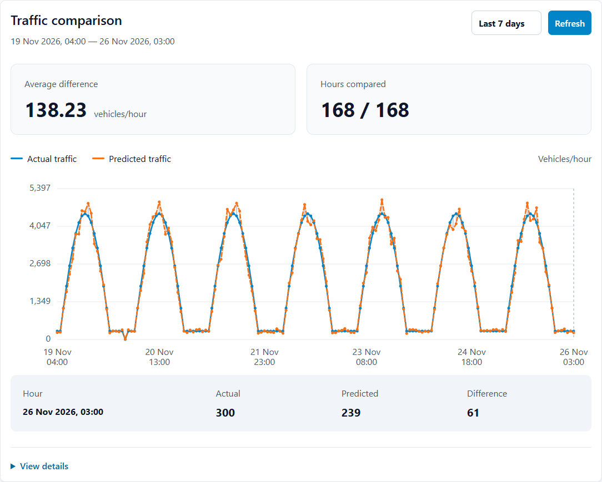
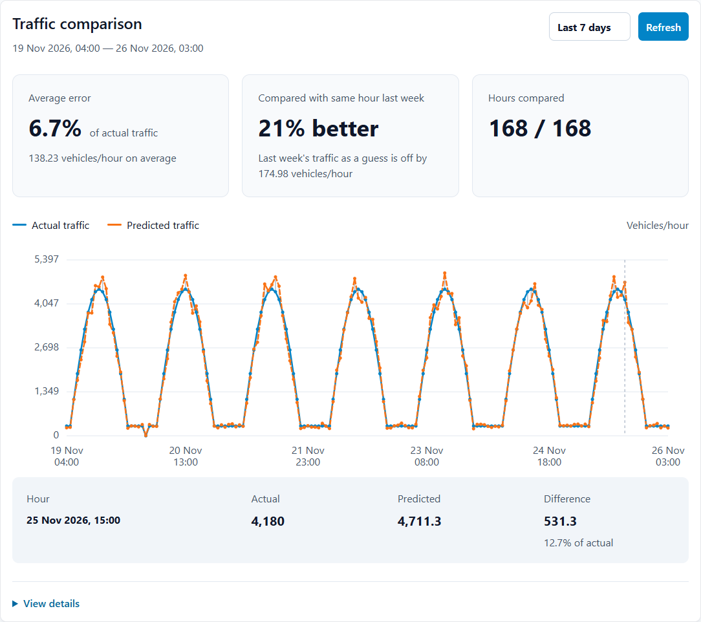
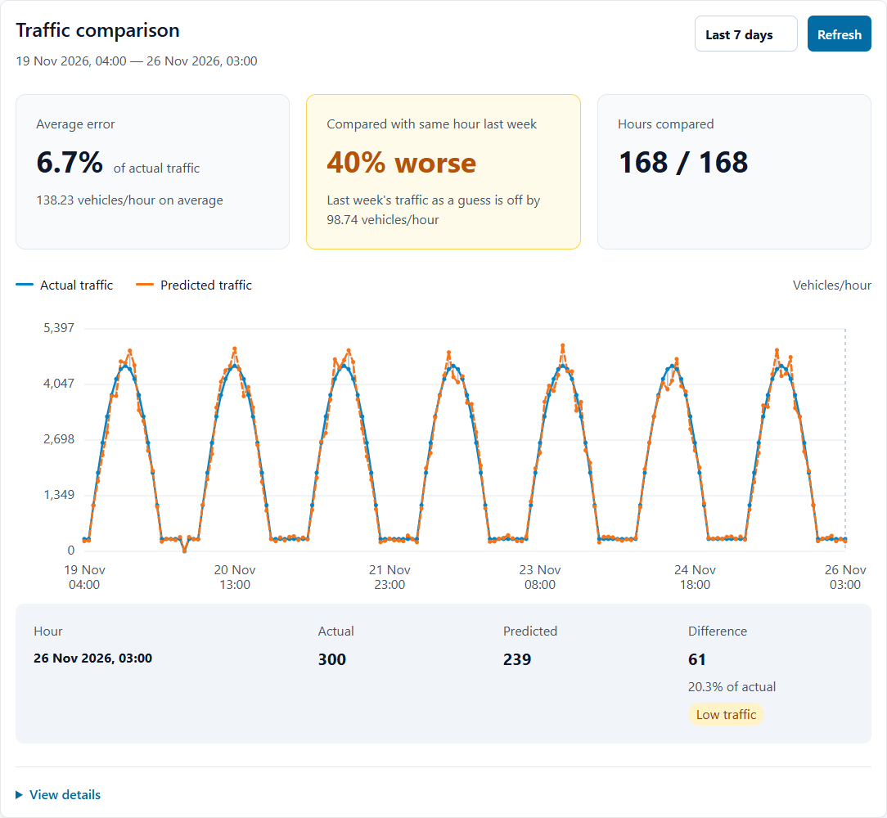
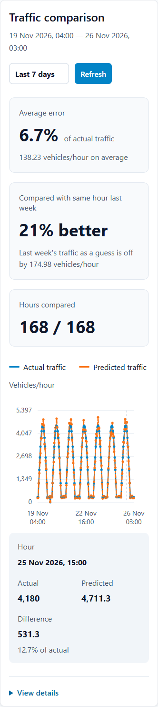

# E2 — Tab Model Quality nên hiển thị sai số thế nào?

> **Cập nhật:** 26/11/2026 · **Trạng thái:** đã chạy, đã kiểm; **đã phát hành** 26/11 (PR #33, run CI/CD 120, commit `d566a09`), kiểm sau CD đạt; chờ người dùng xác nhận
> **Kết luận ngắn:** Tab Model Quality trước đây chỉ hiện **"Average difference" = số xe lệch trung bình (MAE)**. Con số này không cho biết lệch thế là nhiều hay ít: ở Glasgow nó nhỏ nhất (28 xe/giờ) dù model ở đó sai nhiều nhất và **kém hơn cả cách đoán "cùng giờ tuần trước" 40%**. Bản mới hiện **"Average error" = sai bao nhiêu % lưu lượng (WAPE)**, kèm số xe, kèm **"so với cùng giờ tuần trước: tốt hơn / kém hơn N%"**, và từng giờ hiện `số xe (x%)` với nhãn **Low traffic** cho giờ ít xe. Chạy lại bằng đúng hàm backend trên 3 bộ dữ liệu cho cùng số với E1.

## 1. Vì sao cần thực nghiệm này

Ghi chú của GVHD: *"thấy chênh lệch ít thì tưởng dự đoán đúng, nhưng thực ra chênh lệch nhiều lắm"*, nên lấy RMSE hoặc MAE rồi tính ra phần trăm để hiển thị cho chuẩn.

E1 đã chọn chỉ số: hiển thị **WAPE** làm số chính, **MAE** làm số phụ, và **so với cách đoán cùng giờ tuần trước** ([E1 §5](E1-chi-so-danh-gia.md)). E2 đưa lựa chọn đó vào hệ thống thật và đo lại xem màn hình mới có nói đúng điều E1 thấy không.

## 2. Dữ liệu

| Dataset | Loại | Khoảng thời gian (phần test) | Số giờ so được | Model | Ghi chú |
| --- | --- | --- | --- | --- | --- |
| I‑94 Minneapolis | thật | 19/01/2018 – 30/09/2018 | 6.086 | RandomForest | Cao tốc, đông xe |
| Glasgow GD1351_R | thật | 17/02/2023 – 30/09/2023 | 5.021 | LSTM | Đường đô thị, ít xe hơn ~13 lần |
| Hồ Chí Minh | synthetic | 13/09/2025 – 31/12/2025 | 2.632 | RandomForest | Chỉ để kiểm chạy đúng, không phải giao thông thật |

Dự đoán là kết quả **final test** của E1 (`outputs/e1/<bộ>/<model>_final_test_predictions.csv`), model là model hệ thống chọn theo CV MAE. Ảnh giao diện dùng **API synthetic** (dữ liệu giả lập trong script kiểm tra), không gọi hệ thống thật.

## 3. Cách làm

1. **Backend** (`backend/app/services/model_quality.py`): chỉ **thêm** trường, không đổi trường cũ, để frontend cũ vẫn chạy và không cần dừng hệ thống.

   | Trường mới | Nghĩa (lời thường) |
   | --- | --- |
   | `metrics.wape_percent` | Tổng số xe đoán lệch ÷ tổng số xe thực tế × 100 |
   | `metrics.actual_mean` | Lưu lượng thực tế trung bình trong khoảng đang xem |
   | `metrics.low_traffic_below` | Ngưỡng "giờ ít xe" = 25% lưu lượng trung bình |
   | `metrics.baseline` | Cách đoán ngây thơ "lấy đúng giờ đó tuần trước": sai số của nó, sai số của model **trên cùng các giờ**, và `relative_change_percent` (âm = model tốt hơn) |
   | `points[].percent_error` | Giờ đó lệch bao nhiêu % so với thực tế (giờ 0 xe thì để trống) |
   | `points[].low_traffic` | Giờ đó có dưới ngưỡng ít xe không |

2. **Frontend** (`frontend/src/ModelQualityPanel.jsx`, phần chữ tách ở `modelQualityText.js`): thẻ **Average error** (`6.8% of actual traffic` + `226 vehicles/hour on average`), thẻ **Compared with same hour last week** (`30% better`; khi kém hơn thì `40% worse`, nền vàng), dòng chi tiết từng giờ `x% of actual` + nhãn **Low traffic**, bảng chi tiết cột Difference `120 (12%)`. Backend cũ chưa có trường mới thì giữ nguyên giao diện cũ.
3. **Viết test trước rồi mới sửa:** 10 test backend mới (tính tay, ví dụ thực tế 1000/2000/4000/3000, dự báo 1100/1800/3500/3200 → WAPE 10%), 7 test chữ hiển thị (`node --test`), 6 ca kiểm giao diện trên trình duyệt (`frontend/tests/check_model_quality_ui.py`: backend mới/cũ, tốt hơn/kém hơn, Low traffic, giờ 0 xe, 3 khoảng thời gian, không tràn ngang ở 1440/390/320 px).
4. **Chạy lại trên số liệu thật** (`scripts/e2_backend_replay.py`): gọi **đúng hàm `_build_report` của backend**, chỉ thay phần gọi model bằng dự đoán đã lưu của E1. Tính cho cả phần test và cho **từng tuần** (7 ngày là khoảng mặc định của tab).

## 4. Kết quả

### 4.1 Trước và sau trên cùng một model

| Dataset | **Trước:** Average difference | **Sau:** Average error | **Sau:** so với cùng giờ tuần trước |
| --- | --- | --- | --- |
| I‑94 (thật) | 226 vehicles/hour | **6,8%** (226 xe/giờ) | **tốt hơn 30%** (tuần trước lệch 322 xe/giờ) |
| Glasgow (thật) | **28 vehicles/hour** — trông tốt nhất | **11,2%** (28 xe/giờ) — sai nhiều nhất | **kém hơn 40%** (tuần trước chỉ lệch 20 xe/giờ) |
| Hồ Chí Minh (synthetic) | 307 vehicles/hour | **8,5%** (307 xe/giờ) | **tốt hơn 21%** (tuần trước lệch 390 xe/giờ) |

**Đọc thế nào:** chỉ nhìn cột "Trước", Glasgow có vẻ tốt nhất. Nhìn hai cột "Sau", Glasgow sai nhiều nhất theo phần trăm và **còn kém cả cách đoán đơn giản nhất**, đúng điều GVHD cảnh báo. Số ở đây **trùng với E1** (6,8% / 11,2% / 8,5%; 30% / 40% / 21%), nên backend tính đúng như phân tích.

### 4.2 Giờ ít xe

| Dataset | Ngưỡng ít xe | Số giờ ít xe | % sai trung vị: giờ ít xe · giờ thường | Phần đóng góp vào tổng số xe sai |
| --- | --- | --- | --- | --- |
| I‑94 | < 835 xe/giờ | 1.084 (17,8%) | 9,2% · 4,6% | 5,9% |
| Glasgow | < 62 xe/giờ | 24 (0,5%) | 93,3% · 9,3% | 0,9% |
| Hồ Chí Minh | < 906 xe/giờ | 502 (19,1%) | 8,3% · 6,4% | 4,0% |

**Đọc thế nào:** ở giờ ít xe, % từng giờ cao hơn hẳn (Glasgow gấp ~10 lần) dù số xe lệch rất nhỏ và gần như không ảnh hưởng tổng sai số (≤ 6%). Vì vậy % từng giờ phải đi kèm nhãn **Low traffic**, còn số chính phải là WAPE (tính theo tổng xe), không phải trung bình % từng giờ (MAPE).

*Ghi chú:* E1 từng ghi "12,3% so với 4,5%, góp 6,6%" cho I‑94; tính lại thì đó là số của **LightGBM**. Với RandomForest (model hệ thống chọn) là 9,2% / 4,6% / 5,9% như bảng trên; tính tay bằng pandas cho cùng kết quả với backend. Đã ghi rõ tên model vào E1.

### 4.3 Theo từng tuần (khoảng mặc định của tab)

| Dataset | Số tuần | WAPE: thấp nhất · trung vị · cao nhất | So với tuần trước: tốt nhất · trung vị · kém nhất | Số tuần model **kém hơn** tuần trước |
| --- | --- | --- | --- | --- |
| I‑94 | 36 | 4,5% · 5,7% · 19,0% | −75% · −14% · +47% | 8 / 36 |
| Glasgow | 30 | 10,2% · 11,3% · 12,1% | −26% · +44% · +115% | **27 / 30** |
| Hồ Chí Minh | 15 | 4,7% · 8,1% · 12,5% | −50% · −25% · +31% | 1 / 15 |

**Đọc thế nào:** khi admin mở tab (7 ngày), Glasgow sẽ thấy cảnh báo "worse" gần như mọi tuần, tức là tín hiệu ổn định chứ không phải ngẫu nhiên. Ở I‑94, model tốt hơn tổng thể nhưng vẫn có 8 tuần "worse", và WAPE có tuần lên 19%. Vì vậy **một tuần đơn lẻ chưa đủ để kết luận**; dùng tín hiệu này để quyết định retrain là việc của E3.

### 4.4 Giao diện

| Trước (backend cũ) | Sau (model tốt hơn tuần trước) |
| --- | --- |
|  |  |

| Sau: model kém hơn tuần trước, giờ ít xe | Sau: điện thoại 390 px |
| --- | --- |
|  |  |

Ảnh chụp từ bản build thật của frontend với **API synthetic**, nên con số trong ảnh không phải số của bảng 4.1.

### 4.5 Kiểm tra tự động

| Bộ kiểm | Kết quả |
| --- | --- |
| `python -B -m unittest` (toàn bộ, gồm 10 test mới) | 1.035 test, đạt |
| `npm test` (gồm 7 test mới) | 37 test, đạt |
| `npm run build` | đạt |
| `check_model_quality_ui.py` | 6/6 ca đạt |
| Bước dựng gói của CI (`release.py Build`, `components.py`, `role_checks.py fixtures`) chạy ở máy | đạt |

### 4.6 Trên hệ thống thật sau phát hành (26/11, chỉ đọc)

Gọi đúng hàm của tab (`get_model_quality`, 7 ngày gần nhất) trong pod API sau CD; không ghi DB, không train. Hai vùng đang dùng dataset **synthetic**, nên đây là kiểm chức năng chạy đúng, không phải kết luận về giao thông thật.

| Vùng | Model active | Giờ so được | Average error | Số xe lệch TB | So với cùng giờ tuần trước | Giờ ít xe |
| --- | --- | --- | --- | --- | --- | --- |
| Hồ Chí Minh | model_v1 · RandomForest | 168 / 168 | 8,6% | 311 xe/giờ | tốt hơn 7,0% (tuần trước lệch 335) | 31 |
| Hà Nội | model_v1 · RandomForest | 89 / 89 | 13,1% | 491 xe/giờ | tốt hơn 9,4% (tuần trước lệch 542) | 20 |

Hai pod API trả health 200, có trường mới (`wape_percent`, `baseline`…), log 15 phút không có dòng lỗi; bundle GitHub Pages (`index-3Tj8twek.js`, trùng bản build ở máy) có các nhãn mới.

## 5. Kết luận và đề xuất

- **Trả lời câu hỏi:** tab Model Quality nên hiện **% sai theo lưu lượng (WAPE)** làm số chính, **số xe (MAE)** làm số phụ, và **so với cùng giờ tuần trước**. Hiển thị cũ làm Glasgow (model kém nhất) trông tốt nhất; hiển thị mới lộ ra điều đó.
- WAPE là **phần trăm sai**, không phải "độ chính xác": không hiển thị `100% − WAPE`.
- Thay đổi chỉ thêm trường, frontend chịu được backend cũ, nên phát hành không gây gián đoạn.
- Chuyển sang E3: thử dùng "WAPE theo tuần" và "kém hơn tuần trước" làm tín hiệu retrain, so với cách phát hiện drift hiện tại (chỉ nhìn thời tiết/ngày lễ).

## 6. Giới hạn

- Số liệu 4.1–4.3 dùng dự đoán offline của E1 (final test), không phải nhật ký dự đoán của hệ thống đang chạy; trên hệ thống thật, tab chỉ có số khi dataset có dòng sau `train_end_date` (xem [data/README.md](../data/README.md)).
- Ngưỡng "ít xe" 25% là quy ước đặt từ E1, chưa thử ngưỡng khác.
- "Cùng giờ tuần trước" tính theo giờ đồng hồ (168 giờ trước). Vùng có đổi giờ mùa hè (DST) thì tuần có ngày đổi giờ lệch 1 giờ; các vùng hiện tại (Asia/Ho_Chi_Minh) không có DST. Khi chạy lại cho I‑94, múi giờ đặt là UTC vì hệ thống từ chối giờ không tồn tại hoặc bị trùng khi đổi giờ (hành vi cũ, có test riêng).
- Tuần trước rơi vào ngày lễ thì cách đoán tuần trước tệ đi và model trông tốt hơn; chưa tách riêng trường hợp này.

## 7. Cách chạy lại

```bash
# Backend
python -B -m unittest tests.test_model_quality
# Frontend
cd frontend && npm test && npm run build && cd ..
python -X utf8 frontend/tests/check_model_quality_ui.py experiments/figures   # cần Edge + playwright; ghi ảnh E2-*.png
# Số liệu bảng 4.1–4.3 (cần outputs/e1 của E1)
python -X utf8 experiments/scripts/e2_backend_replay.py   # ghi outputs/e2/summary.json, ~15 giây
```

Môi trường: `.venv` Python 3.11.9, pandas 3.0.2, numpy 2.4.4; Node theo `frontend/package.json`. Không có yếu tố ngẫu nhiên ngoài dữ liệu giả lập của script giao diện (seed 7).

## 8. Nguồn tham khảo

| Tài liệu và liên kết | Tác giả/tổ chức | Dùng cho |
| --- | --- | --- |
| [E1 — Chỉ số đánh giá](E1-chi-so-danh-gia.md) và các nguồn trong đó (FPP3 §5.8) | Dự án | Lý do chọn WAPE, MAE, mốc ngây thơ |
| [Hướng dẫn Model Quality](../docs/guides/MODEL_QUALITY.md) | Dự án | Cách tính từng trường, cách đọc trên giao diện |
