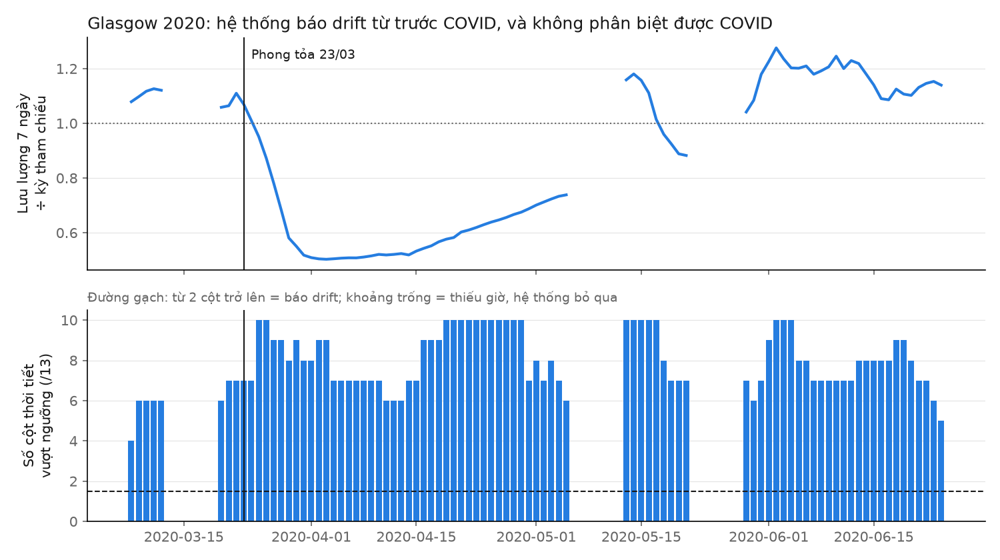
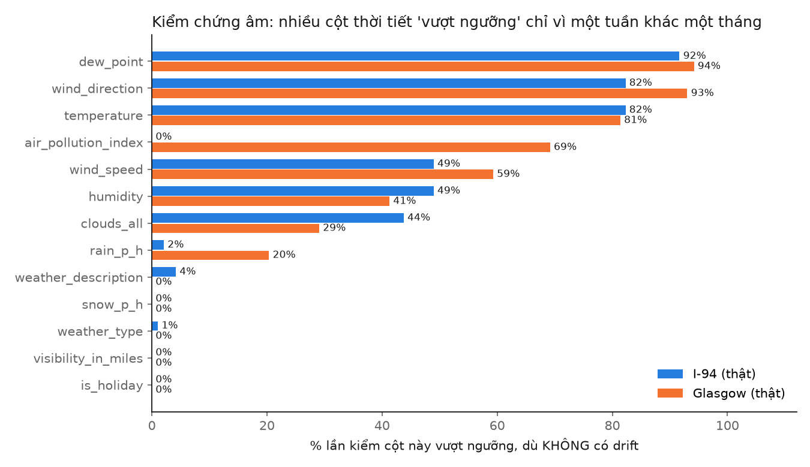
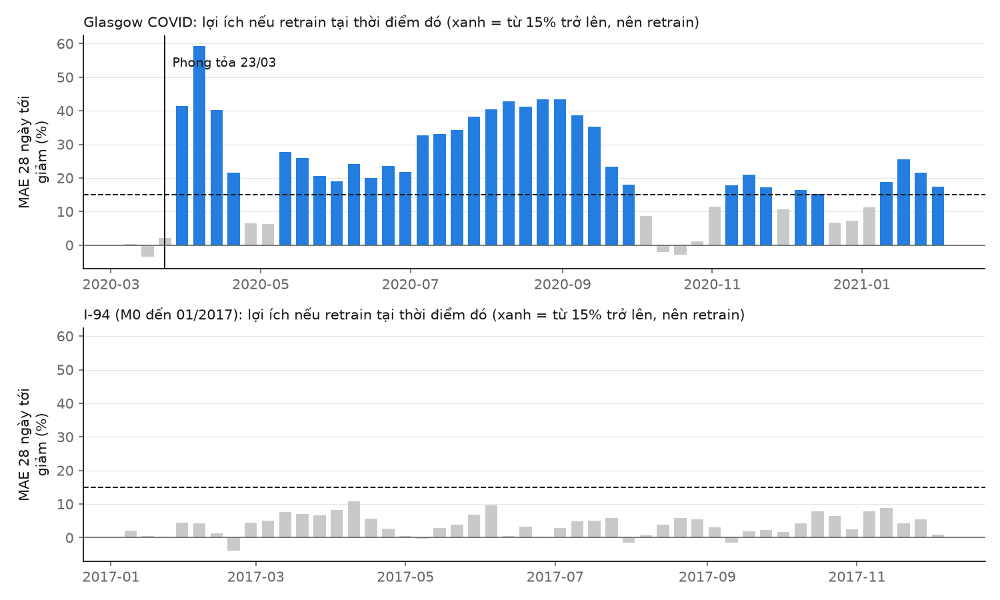
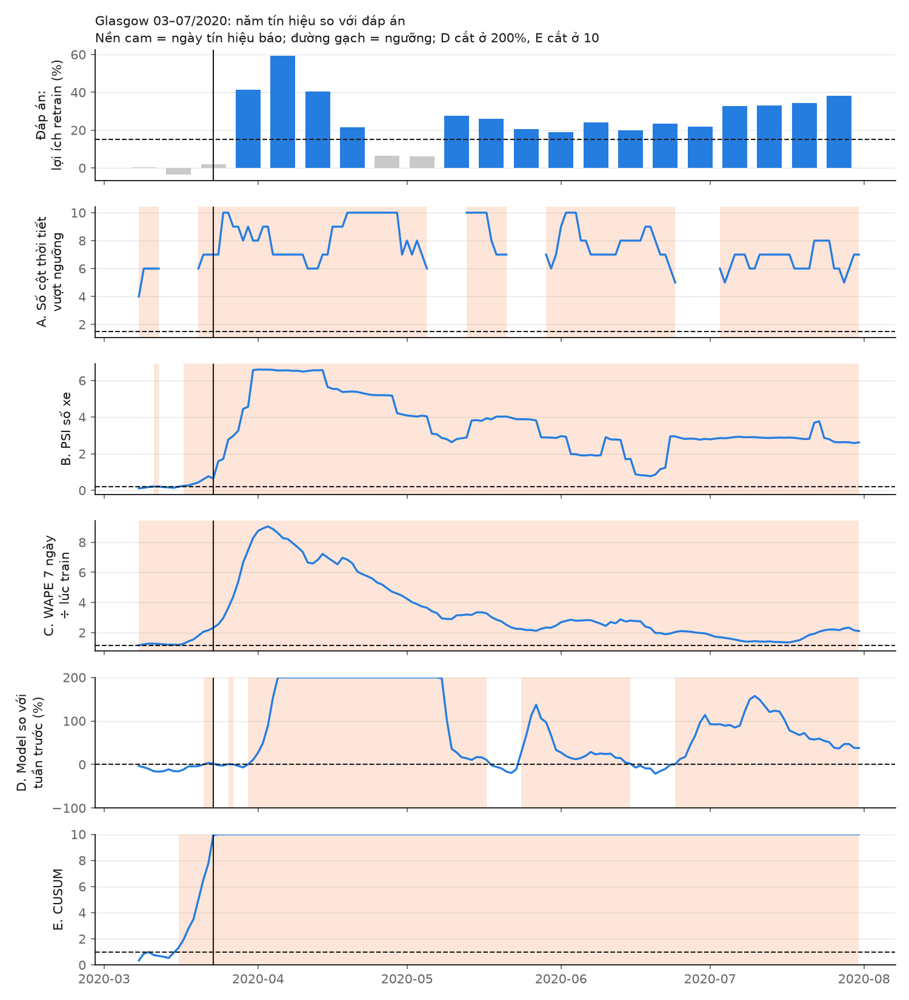
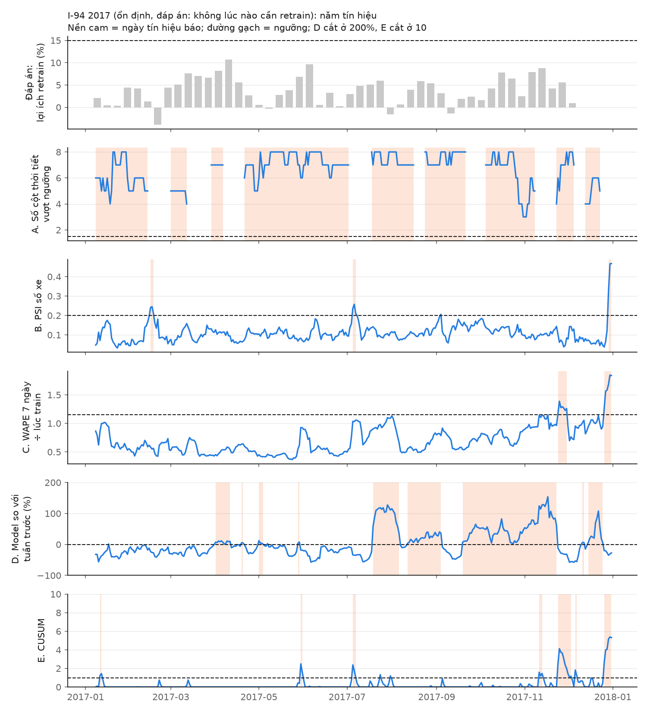
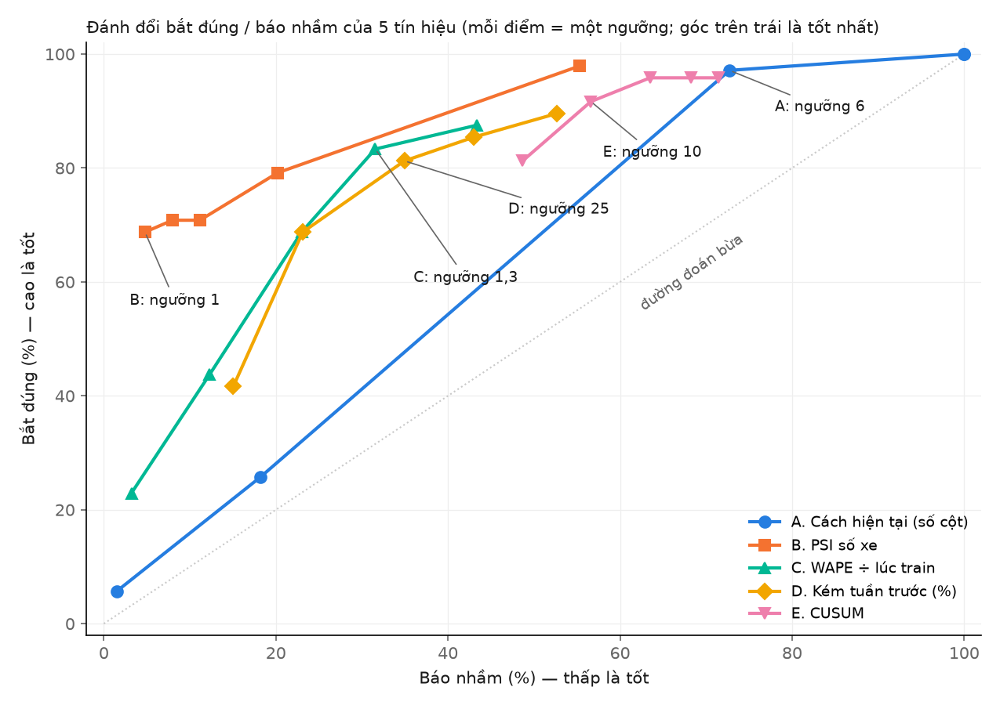
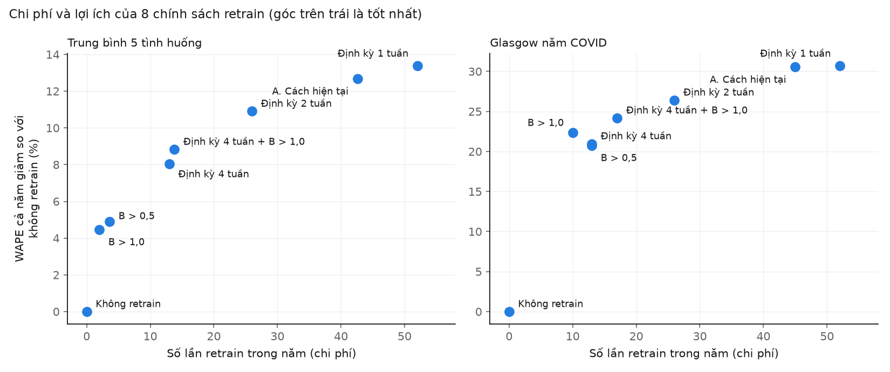

# E3 — Khi nào nên retrain? Tín hiệu nào phát hiện drift tốt nhất?

> **Cập nhật:** 27/11/2026 · **Trạng thái:** đã chạy, đã kiểm (đối chiếu số trong notebook, xem lại từng hình); chờ người dùng xác nhận
> **Kết luận ngắn:** Cách phát hiện drift hiện tại (so thời tiết 7 ngày với 30 ngày tham chiếu) **gần như luôn báo** (≈ 98% kể cả khi chắc chắn không có drift), nên không giúp quyết định retrain. Tín hiệu tốt nhất để phát hiện biến cố là **PSI trên chính số xe** (ngưỡng 1,0): báo nhầm 5%, phát hiện giảm đột ngột 30% sau 5 ngày, báo đúng lúc COVID. Nhưng với model hiện tại, sai số giảm đều theo **số lần retrain**, nên câu trả lời là: **retrain định kỳ** (ví dụ 4 tuần) **cộng PSI số xe > 1,0 để retrain ngay khi có biến cố**; tín hiệu thời tiết chỉ để tham khảo.

## 1. Vì sao cần thực nghiệm này

Ghi chú của GVHD: *đánh giá khi nào nên retrain — tìm chỉ số giúp chức năng phát hiện drift phát hiện tốt hơn.*

Hệ thống hiện tại (`backend/app/services/drift_monitoring.py`, `src/feature_drift.py`, cấu hình `backend/app/core/config.py`) mỗi ngày lúc 00:00 so **13 cột thời tiết/ngày lễ** của **7 ngày gần nhất** với **30 ngày ngay trước `train_end_date`** của model active: cột số dùng PSI (ngưỡng 0,2), cột chữ dùng JS divergence (0,15); **từ 2 cột vượt ngưỡng** là báo drift và có thể tự retrain (nghỉ 72 giờ giữa hai lần; retrain trên 24 tháng gần nhất; model mới là *candidate*, `drift_auto_promote = False`). Tín hiệu **không xét số xe** và **không xét sai số model**.

## 2. Dữ liệu

| Dataset | Loại | Dùng cho | Ghi chú |
| --- | --- | --- | --- |
| Glasgow `GD1351_R` 2019–2023 | thật | Biến cố thật: phong tỏa COVID 23/03/2020; giai đoạn ổn định 10/2022–09/2023 | Trước COVID chỉ có 5 tháng dữ liệu |
| I‑94 Minneapolis 2012–2018 | thật | Giai đoạn ổn định (3 mốc: 07/2016, 01/2017, 07/2017; 36 mốc tháng ở 5.1) | Nhiều giờ thiếu (≈ 77% đủ) |
| I‑94 2017 sửa từ 01/05/2017 | mô phỏng drift | Biết chắc ngày bắt đầu: giảm đột ngột 30%; giảm dần 30% trong 8 tuần | Thời tiết giữ nguyên |
| Hồ Chí Minh synthetic | synthetic | Chỉ kiểm chứng âm ở 5.1 | Không phải giao thông thật |
| `drift_checks` trên hệ thống | quan sát (DB chỉ đọc, 27/11) | Hành vi thật của hệ thống | Hà Nội, Hồ Chí Minh (dataset synthetic) |

## 3. Cách làm

1. **5.1 — Đo cách đang có.** Gọi đúng `calculate_feature_drift` với đúng cấu hình, chọn cửa sổ như `_check_region`; chạy hằng ngày trên Glasgow (model train đến 01/03/2020) và I‑94 (36 mốc train); **kiểm chứng âm**: lấy kỳ hiện tại nằm *bên trong* kỳ tham chiếu (chắc chắn không có drift).
2. **5.2 — Dựng đáp án.** Mỗi thứ Hai: nếu retrain ngay lúc đó (LightGBM nhánh cây hệ thống, 24 tháng gần nhất, seed 42) thì MAE **28 ngày tới** có giảm **≥ 15%** so với giữ model cũ không. Có → "nên retrain". 5 tình huống, 237 thời điểm, 48 "nên retrain".
3. **5.3 — Năm tín hiệu** tính mỗi ngày, chỉ dùng dữ liệu trước ngày đó:

   | Tín hiệu | Nhìn vào | Báo khi (ngưỡng tự nhiên) |
   | --- | --- | --- |
   | A. Cách hiện tại | 13 cột thời tiết/ngày lễ | ≥ 2 cột vượt ngưỡng |
   | B. PSI số xe | phân bố `traffic_volume`, cùng hai kỳ như A | PSI > 0,2 |
   | C. Sai số model | WAPE 7 ngày ÷ WAPE lúc train (đo trên 15% cuối cửa sổ train) | > 1,15 |
   | D. Kém cách đoán tuần trước | MAE model so với "cùng giờ tuần trước", 7 ngày | > 0% |
   | E. CUSUM | cộng dồn phần sai số ngày vượt mức lúc train quá 15% | ≥ 1 |

4. **5.4 — Chấm.** 5 ngưỡng mỗi tín hiệu; *bắt đúng* (recall), *báo nhầm* (false alarm rate), *điểm J* = bắt đúng − báo nhầm, độ trễ ở COVID; thêm 2 drift mô phỏng (chấm theo ngày).
5. **5.5 — Mô phỏng dùng thật.** Mỗi tình huống chạy từng ngày một năm với 8 chính sách (báo → retrain → dùng model mới, kỳ tham chiếu dời theo; nghỉ 72 giờ; 24 tháng); đo WAPE cả năm và số lần retrain.

## 4. Kết quả

### 4.1 Cách hiện tại luôn báo (bước 5.1)

| Thử nghiệm | Kết quả |
| --- | --- |
| Glasgow, model train đến 01/03/2020 | Báo từ lần kiểm đầu **08/03** (trước phong tỏa 15 ngày, lưu lượng lúc đó 1,10 lần tham chiếu); **88/88** ngày kiểm được đều báo |
| I‑94, 36 mốc train | **100%** ngày kiểm báo drift; trung vị lần báo đầu sau 9 ngày; lưu lượng ≈ 1,0 lần tham chiếu |
| Kiểm chứng âm (chắc chắn không drift) | Vẫn báo **97,9%** (I‑94), **98,3%** (Glasgow), 61,3% (Hồ Chí Minh synthetic) |
| Hệ thống thật (12 lần kiểm 12–27/11) | 3 bỏ qua (thiếu giờ), **9/9** còn lại báo drift (4–6/13 cột), 2 lần kích hoạt retrain |

Cột hay "vượt ngưỡng" khi không có drift: điểm sương 92–94%, hướng gió 82–93%, nhiệt độ 81–82% số lần — một tuần thời tiết tự nhiên khác một tháng.




### 4.2 Đáp án (bước 5.2)

| Tình huống | Nên retrain | Lợi ích trung vị | Lần đầu |
| --- | --- | --- | --- |
| Glasgow COVID | 34/48 | 20,8% | **30/03/2020** (lợi ích 41%; 09–23/03 ≈ 0%) |
| Glasgow ổn định | 9/47 | 8,3% | 20/02/2023 |
| I‑94 (07/2016) | 5/47 | 4,4% | 12/09/2016 |
| I‑94 (01/2017) | 0/48 | 4,1% | — |
| I‑94 (07/2017) | 0/47 | 2,1% | — |

Định nghĩa nháp (so từng tuần, model học 3.593 giờ) cho 47% tuần "nên retrain" ở I‑94 ổn định — vô lý, đã bỏ.



### 4.3 Chấm tín hiệu (bước 5.3–5.4)

| Tín hiệu (ngưỡng tốt nhất) | Điểm J | Bắt đúng | Báo nhầm | Trễ COVID | Giảm đột ngột 30% | Giảm dần 30%/8 tuần |
| --- | --- | --- | --- | --- | --- | --- |
| A. Cách hiện tại (≥ 2 cột, đang dùng) | 0,00 | 100% | **100%** | 0 (vốn luôn báo) | không phản ứng | không phản ứng |
| A. (ngưỡng tốt nhất ≥ 6 cột) | 0,24 | 97% | 73% | 0 | — | — |
| **B. PSI số xe (> 1,0)** | **0,64** | 69% | **5%** | 0 ngày, không báo sớm | **5 ngày** | 37 ngày |
| C. WAPE ÷ lúc train (> 1,3) | 0,52 | 83% | 32% | 0 | 3 ngày | 26 ngày |
| D. Kém tuần trước (> 25%) | 0,46 | 81% | 35% | 7 ngày | 9 ngày | 22 ngày |
| E. CUSUM (≥ 10) | 0,35 | 92% | 57% | 0 | 5 ngày | 31 ngày |

Kết hợp B với C (7 quy tắc "hoặc/và") không vượt B đứng riêng (J tốt nhất 0,62). C và E phụ thuộc "WAPE lúc train" — đo trên 15% cuối cửa sổ, dao động 5,8–17,6% tùy mùa — nên cùng ngưỡng lúc quá chặt, lúc quá lỏng. A bị hệ thống bỏ qua 70/237 thời điểm vì thiếu giờ.





### 4.4 Mô phỏng dùng thật (bước 5.5)

WAPE cả năm (số lần retrain trong năm):

| Chính sách | Glasgow COVID | Glasgow ổn định | I‑94 07/2016 | I‑94 01/2017 | I‑94 07/2017 |
| --- | --- | --- | --- | --- | --- |
| Không retrain | 34,4% (0) | 18,9% (0) | 9,3% (0) | 8,3% (0) | 8,6% (0) |
| B > 1,0 | 26,7% (10) | 18,9% (0) | 9,3% (0) | 8,3% (0) | 8,6% (0) |
| B > 0,5 | 27,3% (13) | 18,7% (2) | 9,0% (2) | 8,3% (0) | 8,6% (1) |
| Định kỳ 4 tuần | 27,2% (13) | 17,2% (13) | 8,9% (13) | 8,0% (13) | 8,4% (13) |
| **Định kỳ 4 tuần + B > 1,0** | **26,1% (17)** | 17,1% (13) | 8,8% (13) | 8,0% (13) | 8,4% (13) |
| Định kỳ 2 tuần | 25,3% (26) | 16,5% (26) | 8,6% (26) | 7,9% (26) | 8,3% (26) |
| A. Cách hiện tại | 23,9% (45) | 15,9% (44) | 8,6% (40) | 7,9% (43) | 8,3% (41) |
| Định kỳ 1 tuần | 23,8% (52) | 15,7% (52) | 8,5% (52) | 7,8% (52) | 8,2% (52) |

*Bảng này lấy từ notebook (`outputs/e3/policies.csv`).*

**Đọc thế nào:**
- Sai số **giảm đều theo số lần retrain** ở mọi nơi. Model nhánh cây chỉ dùng thời tiết + lịch, không dùng số xe những giờ trước, nên học lại dữ liệu mới nhất luôn có lợi — kể cả khi không có drift.
- **A** đứng cạnh "định kỳ 1 tuần" không phải vì phát hiện đúng mà vì **luôn báo**, thành một chiếc đồng hồ retrain hằng tuần vô tình (mỗi lần cần 7 ngày sau mốc train mới tính được). Trên hệ thống thật lợi ích này cũng không tự có, vì model mới chỉ là *candidate*.
- **B** chỉ retrain khi có biến cố: ở Glasgow năm COVID, lần đầu ngày **24/03/2020** (ngay sau phong tỏa), 10 lần trong năm, sai số gần bằng định kỳ 4 tuần; ở nơi ổn định gần như không retrain.
- **Định kỳ 4 tuần + B** có chi phí như "4 tuần" ở nơi ổn định và phản ứng nhanh ở biến cố.
- Ở nơi ổn định chênh lệch giữa các chính sách **nhỏ** (I‑94 ≈ 0,5 điểm WAPE); ở biến cố **lớn** (COVID 34,4% → 23,8–27,2%).



## 5. Kết luận và đề xuất

**Trả lời câu hỏi:**
1. **Tín hiệu drift tốt nhất** trong 5 tín hiệu là **PSI trên `traffic_volume`**, ngưỡng **1,0** (cùng hàm `_numeric_psi` hệ thống đã có, không cần model).
2. **Khi nào nên retrain:** với model hiện tại, **định kỳ** (tần suất chọn theo chi phí: 4 tuần ≈ 13 lần/năm/vùng; 2 tuần ≈ 26) **và ngay khi PSI số xe > 1,0**. Tín hiệu thời tiết không nên là điều kiện retrain.

**Đề xuất cho hệ thống** (chưa làm; cần người dùng/GVHD quyết):

| # | Đề xuất | Bằng chứng | Mức thay đổi |
| --- | --- | --- | --- |
| 1 | Đổi điều kiện tự retrain từ "≥ 2 cột thời tiết" sang **PSI `traffic_volume` > 1,0** (giữ cửa sổ 7/30 ngày, 168 giờ, nghỉ 72 giờ) | J 0,00 → 0,64; báo nhầm 100% → 5% | Nhỏ (backend `drift_monitoring`, cấu hình) |
| 2 | Giữ báo cáo drift thời tiết để **hiển thị/tham khảo**, không làm điều kiện retrain | Luôn báo, không mang thông tin | Nhỏ (giao diện Drift ghi rõ) |
| 3 | Thêm **retrain định kỳ** (ví dụ 4 tuần) | Sai số giảm đều theo số lần retrain | Vừa (lịch Airflow); chi phí Kaggle ≈ 4–5 phút mỗi lượt 5 model (đo 24/11) |
| 4 | Quyết định có **tự Activate** candidate khi đạt kiểm tra chất lượng hay không | Lợi ích retrain chỉ có khi model mới được dùng | Chính sách vận hành |
| 5 | Trước mắt, nếu chưa đổi (1): **tắt tự retrain theo drift thời tiết** | Trên hệ thống thật 9/9 lần kiểm báo drift, đã kích hoạt 2 lần retrain | Bật/tắt có sẵn |

## 6. Giới hạn

- Chỉ dùng **LightGBM** của nhánh cây (nhánh cây thật chọn giữa RF/XGB/LightGBM; LSTM/GRU dùng số xe giờ trước nên có thể ít cần retrain hơn — chưa đo).
- **Hai bộ dữ liệu thật**, Glasgow chỉ một cảm biến; model Glasgow trước COVID chỉ học 5 tháng. Drift mô phỏng chỉ có một mức (30%).
- Ngưỡng được dò trên **chính** 237 thời điểm dùng để chấm (5 mức mỗi tín hiệu) — có thể hơi lạc quan; chưa kiểm trên dữ liệu khác.
- Đáp án dựa trên quy ước 15% / 28 ngày / 24 tháng; quy ước khác có thể đổi số "nên retrain".
- Mô phỏng giả định model mới **được dùng ngay**; chi phí chỉ đếm số lần retrain, chưa tính thời gian/lỗi của Kaggle.
- Bỏ qua đổi giờ mùa hè (I‑94 dùng giờ địa phương như dataset).
- Giả thuyết chưa kiểm: cây có dùng số xe giờ trước (E1) có thể giảm nhu cầu retrain thường xuyên.

## 7. Cách chạy lại

```bash
python -X utf8 experiments/scripts/build_e3_notebook.py experiments/notebooks/E3-drift-retrain.ipynb
```

Dựng và chạy toàn bộ notebook (≈ 7 phút trên i7-10750H). Ghi `experiments/outputs/e3/` (`truth_*.csv`, `signals_*.csv`, `policies.csv`) và `experiments/figures/E3-*.png`. Môi trường: `.venv` Python 3.11.9, pandas 3.0.2, numpy 2.4.4, LightGBM 4.7.0; seed 42. Ô 5.1d (đọc `drift_checks`) là số ghi lại, không chạy lại được ngoài hệ thống.

## 8. Nguồn tham khảo

| Tài liệu và liên kết | Tác giả/tổ chức | Dùng cho |
| --- | --- | --- |
| Mã hệ thống: `src/feature_drift.py`, `backend/app/services/drift_monitoring.py`, `backend/app/core/config.py` | Dự án | Định nghĩa PSI/JS, cửa sổ, ngưỡng; chạy lại đúng cách hệ thống |
| [E0 — Dataset](E0-dataset.md) (nguồn UCI I‑94 và Glasgow Zenodo) | Dự án | Dữ liệu thật, COVID ở Glasgow |
| [E1 — Chỉ số đánh giá](E1-chi-so-danh-gia.md) | Dự án | Chọn họ MAE/WAPE để theo dõi; model cây không dùng số xe giờ trước |

Chưa tra cứu tài liệu ngoài về PSI, CUSUM trong giai đoạn này; định nghĩa PSI lấy từ mã hệ thống.
