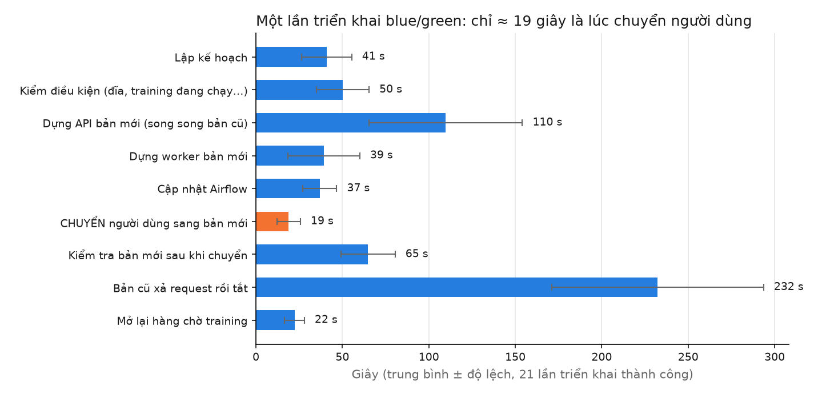
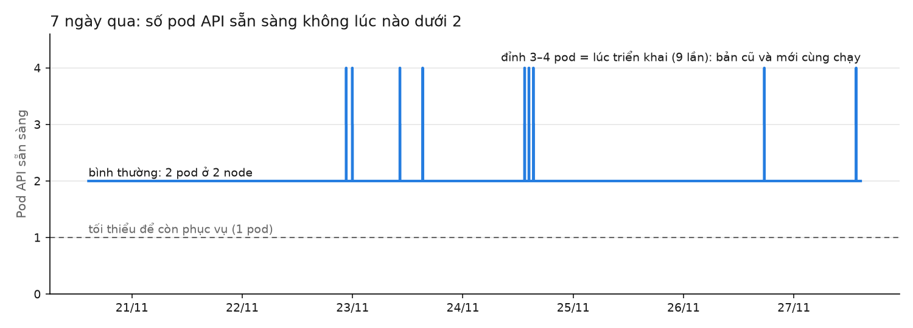

# E4 — Hệ thống sẵn sàng, chịu lỗi và chịu tải đến đâu?

> **Cập nhật:** 27/11/2026 · **Trạng thái:** 6.1, 6.2 đã chạy (chỉ đọc); 6.3 đã viết (nhánh, chưa phát hành); 6.4–6.6 chưa làm · **Notebook:** [notebooks/E4-san-sang-chiu-loi-chiu-tai.ipynb](notebooks/E4-san-sang-chiu-loi-chiu-tai.ipynb) (dựng bằng `scripts/build_e4_notebook.py`)
> **Kết luận ngắn (tạm, sau 6.1):** phần phục vụ dự báo đã được thiết kế để chịu mất một pod (2 pod ở 2 node, luôn giữ tối thiểu 1, xả request trước khi tắt). Điểm yếu nằm ở chỗ khác: cơ sở dữ liệu và kho file chỉ có một bản trên node-02, đường vào đi qua một máy (node-01) và một tài khoản ngrok miễn phí giới hạn 20.000 request mỗi tháng. Hệ thống chưa tự ghi độ trễ và lỗi của request nên chưa có số uptime; bước 6.3 thêm phần đo này.

## 1. Vì sao cần thực nghiệm này

GVHD yêu cầu "đánh giá tính sẵn sàng của hệ thống, khả năng chịu lỗi, chịu tải". Ba tính chất được đo như sau:

| Tính chất | Nghĩa bằng lời thường | Chỉ số |
| --- | --- | --- |
| Sẵn sàng (availability) | Người dùng mở web thì dịch vụ có trả lời không | % thời gian hoạt động (uptime); thời gian gián đoạn khi phát hành; tỉ lệ request lỗi |
| Chịu lỗi (fault tolerance) | Một phần hỏng thì cả hệ thống có sập không | Số request mất và thời gian tự phục hồi khi mất một pod; thời gian rollback khi phát hành lỗi |
| Chịu tải (load capacity) | Chịu được bao nhiêu người dùng cùng lúc | Số request/giây tối đa trước khi chậm hoặc lỗi; độ trễ p95 theo mức tải |

Các bước: 6.1 khảo sát (file này, mục 3) → 6.2 đọc lại lịch sử phát hành → 6.3 thêm số đo vào hệ thống (Prometheus/Grafana) → 6.4 kiểm tải → 6.5 kiểm chịu lỗi → 6.6 báo cáo.

## 2. Dữ liệu

Cụm RKE2 thật đang chạy (3 node), đọc ngày 27/11/2026 lúc ~14:00, chỉ đọc (`kubectl get/top/logs`, đọc mã nguồn, API GitHub GET, một request `GET /health/live` thử đường vào). Không đổi gì trên cụm.

## 3. Bước 6.1 — Khảo sát: hệ thống đang được bảo vệ thế nào

### 3.1 Đường đi của một request

```text
Trình duyệt → GitHub Pages (giao diện tĩnh)
           → ngrok miễn phí (HTTPS, *.ngrok-free.app)
           → Nginx trên node-01 (:8080, ngoài Kubernetes)
           → NodePort 30080 (Service traffic-api)
           → 1 trong 2 pod API (api-next, node-02 và node-03)
                ├→ PostgreSQL (1 bản, node-02)
                └→ MinIO (1 bản, node-02) · MLflow (1 bản, node-02)
```

### 3.2 Những gì đã có để chịu lỗi (đọc từ cấu hình thật)

| Cơ chế | Cấu hình thật | Ý nghĩa |
| --- | --- | --- |
| 2 pod API ở 2 node khác nhau | `podAntiAffinity` **bắt buộc** theo `hostname`, chỉ được chạy trên node-02/03 | Hỏng một node thì pod ở node kia vẫn phục vụ |
| Giữ tối thiểu 1 pod | PodDisruptionBudget `api-availability`: `minAvailable 1` | Bảo trì/drain node không được tắt cả hai pod cùng lúc |
| Cập nhật không giảm số pod | `maxUnavailable 0`, `maxSurge 1`, `minReadySeconds 20`; phát hành blue/green (`api` ↔ `api-next`) | Bản mới phải sẵn sàng trước khi bản cũ bị gỡ |
| Kiểm tra sức khỏe | readiness `/health/serving-ready` mỗi 5 s (3 lần lỗi → rút khỏi Service, ≈15 s); liveness `/health/live` mỗi 20 s; startup cho tối đa 300 s | Pod chưa sẵn sàng (đang tải model) không nhận request; pod treo bị khởi động lại |
| Xả request trước khi tắt | `preStop` chạy `backend.app.services.lifecycle`, `terminationGracePeriodSeconds 900` | Request đang chạy được làm xong trước khi pod tắt |
| Chặn quá tải có chủ đích | Dự báo (POST): 120 lần/phút cho mỗi người dùng + IP, đếm trong bộ nhớ từng pod → 429. Đăng nhập: 20/phút. Model Quality: mỗi pod chỉ tính 1 báo cáo một lúc, lượt khác nhận 503 `quality_busy` (từ chối thay vì xếp hàng vô hạn), giữ 4 báo cáo gần nhất | Một người gọi dồn không làm nghẽn cả pod |
| Rollback khi phát hành lỗi | CD Verify lỗi → rollback tự động; Auto bị chặn tới khi phục hồi (xem `docs/guides/CD_MODES.md`) | Đã xảy ra thật: run 122 lỗi ngày 27/11, hệ thống vẫn chạy bản cũ, không downtime |

Tài nguyên lúc khảo sát (gần như không có người dùng): mỗi pod API dùng ≈0,69 GiB RAM / giới hạn 3 GiB, CPU 7m / giới hạn 1 core. Node: CPU 5–11%, RAM node-01 51%, node-02 33%, node-03 50%.

Mỗi pod API chạy **1 tiến trình** Uvicorn (`workers=1`) và **tắt access log**, nên hiện không có bản ghi từng request để tính lưu lượng hay tỉ lệ lỗi.

### 3.3 Bản đồ điểm hỏng đơn lẻ

| Nếu hỏng… | Ảnh hưởng tới người dùng | Tự phục hồi? |
| --- | --- | --- |
| 1 pod API | Không thấy (pod còn lại phục vụ) | Có — Kubernetes tạo lại pod |
| node-03 | Mất 1 pod API (pod còn lại phục vụ); **Airflow dừng** → drift hằng ngày và điều phối train dừng | API: có; Airflow: chỉ khi node trở lại |
| node-02 | **PostgreSQL, MinIO, MLflow dừng** (1 bản, dữ liệu nằm trên ổ của node-02) → đăng nhập, dự báo, train đều lỗi dù 1 pod API còn chạy | Không — chờ node-02 trở lại |
| node-01 | **Mất đường vào** (Nginx + ngrok ở đây); mất control plane (không lên lịch pod mới); mất Prometheus/Grafana | Không |
| Hạ tầng cloud của trường (cả 3 node) | Mất toàn bộ dịch vụ — **đã xảy ra 08/11** | Một phần: sau khi node được reboot, dịch vụ tự lên lại trong ≈ 3 phút |
| ngrok (dịch vụ ngoài hoặc hết hạn mức) | Web không gọi được API | Không — chờ ngrok hoặc sang tháng mới |
| GitHub Pages | Không mở được giao diện (API vẫn chạy) | Phụ thuộc GitHub |
| Máy Windows / Tailscale / runner | Không phát hành được bản mới; **dịch vụ đang chạy không ảnh hưởng** | — |

### 3.4 Hạn mức ngrok — một giới hạn sẵn sàng thật

Gói ngrok miễn phí: **20.000 HTTP request mỗi tháng**, tối đa **4.000 request/phút**, 1 GB truyền dữ liệu/tháng ([ngrok — Free Plan Limits](https://ngrok.com/docs/pricing-limits/free-plan-limits)). Vượt hạn mức tháng thì web mất kết nối API tới chu kỳ sau.

Giao diện tự gọi API định kỳ ở vài chỗ (`frontend/src`): theo dõi training mỗi **2 s** khi tab đang mở (`TrainingMonitor.jsx`), trạng thái lượt train mỗi 4 s (`main.jsx`), Model Quality thử lại sau 30 s. Ước tính: mở tab theo dõi training 1 giờ ≈ 1.800 request ≈ **9% hạn mức tháng**.

Đánh giá: **hiện vẫn dùng được** — ngrok là đường vào từ 08/10 (≈7 tuần), nhật ký không ghi lần nào hết hạn mức; vài người dùng bình thường nằm trong ≈650 request/ngày. Rủi ro khi theo dõi nhiều lượt train dài, khi nhiều người cùng mở web (ngày bảo vệ), và giới hạn 1 GB/tháng với các phản hồi lớn (Model Quality, dự báo; đo kích thước ở 6.4). Đề xuất: giữ ngrok; ở 6.3 giảm tần suất gọi của tab theo dõi training và chỉ gọi khi có lượt train đang chạy; cho Grafana hiện mức request trong tháng so với 20.000 (nếu tách được request từ web với request nội bộ); xem lại mức dùng vài ngày trước bảo vệ. Phương án thay thế lâu dài (chưa làm, người dùng quyết): Cloudflare Tunnel có tên (cần tên miền), Tailscale Funnel (giới hạn băng thông không công bố), ngrok trả phí; Cloudflare Quick Tunnel không hợp (đổi địa chỉ mỗi lần chạy, không cam kết uptime).

Hệ quả cho các bước sau: **kiểm tải không được đi qua ngrok**. Máy phát triển gọi thẳng được vào cụm qua Tailscale: `GET /health/live` tới Nginx node-01 (:8080) → 200 trong 0,036 s, tới NodePort 30080 → 200 trong 0,056 s.

### 3.5 Giám sát hiện có

- Prometheus giữ dữ liệu **7 ngày** (`retention=7d`), nhận mọi ServiceMonitor có nhãn `release=traffic-monitoring` ở mọi namespace → thêm số đo cho API chỉ cần một ServiceMonitor, không cài thêm thành phần.
- Đang thu: node (node-exporter), pod (kubelet, kube-state-metrics), apiserver, CoreDNS, Grafana, Prometheus. **Chưa có**: số đo request của API (độ trễ, lỗi), đầu dò gọi health từ ngoài (blackbox), Alertmanager.
- Prometheus, Grafana nằm trên node-01 → hỏng node-01 thì mất cả giám sát.
- Vì giữ 7 ngày, số uptime/độ trễ cho báo cáo phải được **xuất ra file** trước khi hết hạn.

### 3.6 Dữ liệu lịch sử phát hành (cho 6.2)

GitHub còn giữ **86** báo cáo `delivery-metrics` (10/11–27/11; lúc khảo sát chỉ đọc 3 trang đầu nên đếm nhầm 38); bản cũ hơn đã hết hạn. Đã tải về ở 6.2. Nhiều pod nền (PostgreSQL, MinIO, Prometheus) có lần khởi động lại cách đây ≈19 ngày (≈08/11) → 6.2 đối chiếu nhật ký xem đó có phải một lần gián đoạn.

### 3.7 Đoán trước (để kiểm ở 6.4–6.5)

| Tình huống | Đoán | Lý do |
| --- | --- | --- |
| Xóa 1 pod API có kế hoạch, trong lúc gọi liên tục | 0–1 request lỗi; pod mới sẵn sàng sau 1–3 phút | preStop xả request, pod bị rút khỏi Service ngay khi bắt đầu tắt |
| Pod treo đột ngột (không kịp xả) | Request tới pod đó lỗi/chậm tối đa ≈15 s | readiness lỗi 3 lần × 5 s mới bị rút |
| Phát hành blue/green trong lúc có tải | 0 request lỗi | Service chỉ chuyển khi bản mới đã warm/preview |
| Tải đọc trang dự báo (GET) tăng dần | Bắt đầu chậm ở khoảng 10–30 request/giây cho cả 2 pod | Mỗi pod 1 tiến trình, giới hạn 1 core |
| Một người gọi dự báo (POST) dồn dập | Nhận 429 sau 120 lần/phút mỗi pod — **chặn có chủ đích**, không phải sập | Rate limit trong `predictions.py` |

### 3.8 Ràng buộc an toàn cho 6.4–6.5 (chờ người dùng duyệt)

- Gọi thẳng qua Tailscale, **không qua ngrok**; giờ vắng; tải tăng dần; **dừng ngay** khi lỗi > 1%, p95 > 2 s hoặc CPU node > 80%.
- Chỉ gọi API đọc (GET trang dự báo, cửa sổ dự báo) và health; không gọi train, Activate, xóa. Mọi API trừ health đều cần đăng nhập → cần một **tài khoản thử** do người dùng tạo; token đọc từ biến môi trường, không in ra, không ghi vào Git.
- Xóa pod (6.5) là thay đổi trên cụm → người dùng thực hiện, AI đo. Không thử tắt PostgreSQL/node-02 (đã biết sẽ gián đoạn; ghi là giới hạn ở 3.3).

## 4. Kết quả

### 4.1 Bước 6.2 — Lịch sử thật: phát hành, rollback, 7 ngày sẵn sàng

**Dữ liệu:** 86 báo cáo `delivery-metrics` của CI/CD (10/11–27/11, phần GitHub còn giữ) → [`outputs/e4/delivery_runs.csv`](outputs/e4/delivery_runs.csv) bằng [`scripts/e4_delivery_table.py`](scripts/e4_delivery_table.py) (bản gốc tải chỉ đọc vào `results/e4/delivery/`, Git bỏ qua). Prometheus 7 ngày (20/11–27/11, kube-state-metrics: pod/node Ready, mẫu 10–30 s) → [`outputs/e4/availability_7d.json`](outputs/e4/availability_7d.json), [`outputs/e4/api_ready_timeline.csv`](outputs/e4/api_ready_timeline.csv) bằng [`scripts/e4_prometheus_availability.py`](scripts/e4_prometheus_availability.py).

| Chỉ số | Kết quả | Ghi chú |
| --- | --- | --- |
| Số lần triển khai thật lên cụm | 23 (21 thành công, 2 tự rollback) | Thêm 5 lượt "không có gì đổi" không đụng cụm; 58 lượt PR/kiểm thử |
| Tỉ lệ phát hành lỗi | 2/23 ≈ **9%** | Cả hai ngày 19/11; các lần dừng **trước** khi đụng cụm (19/11 lệnh pod quá thời gian, 27/11 thiếu đĩa) không gây gián đoạn |
| Đẩy mã → bản mới chạy thật | trung vị **17,8 phút**; trung bình 24,5 ± 20,3; 14,2–106,1 | Lệch phải: 106 phút (đổi runtime 10/11) và 38 phút (27/11, gồm chờ dọn đĩa) |
| Phần triển khai trên cụm | **9,7 ± 1,8 phút** (6,8–13,7) | Ổn định |
| Pha chuyển người dùng (`promote`) | **19 ± 7 giây** (10–31) | Trước đó ≈ 4 phút dựng bản mới song song; sau đó ≈ 3,9 phút bản cũ xả request rồi tắt |
| Lỗi → rollback xong | **7,7** và **5,8 phút** | Tự động; nhật ký ghi "rollback an toàn" |
| Pod API Ready (7 ngày, 10.080 phút) | **≥ 2 suốt 100%**, min = 2 (kiểm lại ở mẫu 15 s) | 9 lần triển khai trong cửa sổ: số pod lên 3–4 (≈ 35 phút) vì bản mới dựng trước khi tắt bản cũ |
| PostgreSQL, MinIO, MLflow, Airflow, 3 node | **100%** Ready, 0 lần pod khởi động lại | Tuần ít sự cố |
| Lần mất toàn bộ gần nhất | **Sự cố 08/11**: cloud của trường gặp sự cố, các node lỗi, người dùng reboot cả 3 node (12:32–12:34) | Sau reboot, Kubernetes **tự** đưa dịch vụ lên lại: PostgreSQL/MinIO chạy ≈ 3 phút sau node đầu tiên (12:35:30), không thao tác pod bằng tay. Thời lượng gián đoạn **không đo được** (chưa có đầu dò ngoài). Từ đó cụm chạy liên tục ≈ 19 ngày |



*Đọc hình:* chỉ thanh cam (≈ 19 s) là lúc người dùng được chuyển sang bản mới; các pha khác chạy song song hoặc sau khi đã chuyển.



*Đọc hình:* đường nằm ở 2 pod suốt 7 ngày, chỉ vọt lên 3–4 lúc triển khai; không lần nào chạm đường 1 pod.

**Giới hạn của 6.2:** "pod Ready" là có pod sẵn sàng nhận việc, **chưa phải** tỉ lệ request thành công; khoảng hở ngắn hơn chu kỳ ghi (10–30 s) có thể không thấy; 7 ngày là toàn bộ dữ liệu Prometheus giữ; hai lần rollback nằm ngoài 7 ngày nên không đối chiếu được số pod Ready.

### 4.2 Bước 6.3 — Áp dụng: để hệ thống tự đo (nhánh `feat/e4-availability-metrics`, chưa phát hành)

Bước 6.2 cho thấy hai lỗ hổng đo lường: chỉ biết "pod sẵn sàng" chứ không biết request có thành công và nhanh không; lần sự cố 08/11 không đo được thời lượng. Thay đổi:

| Phần | Thay đổi | Vì sao |
| --- | --- | --- |
| Backend | `backend/app/core/metrics.py` + middleware: đếm request, đo thời gian trả lời (histogram 25 ms–30 s), request đang xử lý; nhãn = mẫu route, mã trạng thái, phương thức, nguồn (`web`/`proxy`/`cluster`/`probe`), không lưu IP. Phản hồi "busy" của `PredictionGate` (trả trước router) vẫn mang đúng tên route | Có số độ trễ p50/p95 và tỉ lệ lỗi trên lưu lượng thật |
| Cổng riêng | Pod API phục vụ số đo ở cổng **9464**; đường public chỉ tới cổng 8000 nên `/metrics` không lộ ra ngoài; không đổi manifest pod (PodMonitor dùng `portNumber`) | An toàn, không đụng đường phát hành |
| Prometheus | [`deployment/observability/api-podmonitor.yaml`](../deployment/observability/api-podmonitor.yaml) (mỗi 15 s, cả hai slot blue/green) — người dùng áp dụng một lần sau phát hành | Prometheus thu số đo |
| Grafana | System Overview thêm hàng **Website service**: sẵn sàng 7 ngày, thời gian trả lời 95%, % request lỗi, request từ website trong 24 h so với hạn mức ngrok/ngày; mục thu gọn **Request details** (biểu đồ). Cập nhật Grafana thật sau khi người dùng xem bản xem trước | Trực quan cho người không chuyên |
| Giao diện | Tab theo dõi training gọi API mỗi **5 s khi có lượt train** (trước: 2 s), **20 s khi không có**, và làm mới ngay khi bấm Train/Retrain | 1 giờ theo dõi: 720 request thay vì 1.800 (−60%) |
| Thư viện | `prometheus-client==0.26.0` (ngày phát hành 24/07/2026) | Thư viện chuẩn của Prometheus |

Không đổi: số pod, PDB, anti-affinity, blue/green, rate limit, `PredictionGate`, mô hình, dữ liệu. Không có migration.

Phát hiện khi đọc mã (dùng cho 6.4): mỗi pod chỉ chạy **1 lượt dự báo tại một thời điểm** (khóa `serialized`), `PredictionGate` cho tối đa 1 đang chạy + 8 chờ (chờ tối đa 60 s), quá mức trả **503 busy** ngay — cơ chế tự bảo vệ khi quá tải. Khả năng chịu tải của trang dự báo vì vậy bị giới hạn bởi thời gian một lượt dự báo × 2 pod.

### 4.3 Sự cố thật khi phát hành 6.3 (27/11) — chịu lỗi được kiểm chứng ngoài ý muốn

Bản 6.3 (PR #35, `3ec28f2`) thêm một thư viện nên phải dựng lại mọi image. Diễn biến (giờ VN):

| Giờ | Sự kiện |
| --- | --- |
| 14:59–15:12 | CI đạt (dựng lại 4 image) |
| 15:14 | Dựng API bản mới: node-03 kéo image (0,52 GiB nén) ≈ 2 phút; **node-02 kéo > 10 phút** |
| 15:25 | Rollout quá hạn 600 s → engine **tự rollback**: thu bản mới, giữ bản cũ |
| 15:25–15:41 | Pod mới trên node-02 chờ hết thời gian tắt 900 s (preStop lỗi) → lease guard 2400 s hết trước khi engine ghi xong → CD **chặn**, `recovery_required` |
| 15:55–16:16 | Kiểm chỉ đọc: tài nguyên duy nhất đã patch (slot `api`) **trùng 100% spec trước phát hành**; phát hiện engine đã **tạm dừng 2 DAG** (training, drift) và chưa bật lại → người dùng bật lại; công cụ mới `scripts/cicd/recover_lease_lost.py` chứng minh trạng thái rồi nhả chốt CD |
| 16:10 | Người dùng kéo trước image tree (node-02), neural (node-03) |
| 16:18–16:31 | Chạy lại (Manual): CI ≈ 3 phút, pod API mới sẵn sàng sau ≈ 4 phút, **đạt** |

**Người dùng không bị gián đoạn lúc nào**: Service luôn trỏ về 2 pod bản cũ, health 200 suốt sự cố. Thời gian từ lỗi đầu tiên tới bản mới chạy: ≈ 66 phút, phần lớn là chờ (lease, kiểm chứng, thao tác người).

Bài học cho hệ thống: (1) mạng node-02 chậm là giới hạn hạ tầng — bản đổi thư viện nên kéo trước image; (2) khi rollback bị ngắt, DAG có thể bị bỏ ở trạng thái tạm dừng — phải kiểm DAG sau mọi sự cố CD; (3) chuỗi "rollout timeout 600 s + grace 900 s" có thể vượt lease 2400 s — đề xuất xem lại (chưa đổi). Hướng dẫn phục hồi: `docs/guides/CD_MODES.md`, mục "Lease hết hạn giữa lúc rollback".

Sau phát hành, kiểm sau CD phát hiện nhãn route bị sai (FastAPI giữ router lồng nhau nên `route.path` chỉ là phần tương đối, có route ra `""` → "unmatched"); đã sửa bằng mẫu route đầy đủ từ OpenAPI của app (test tái hiện đúng lỗi) — chờ phát hành.

## 5. Kết luận và đề xuất

(Bổ sung ở 6.6.)

## 6. Giới hạn

- Bước 6.2: xem giới hạn ở cuối mục 4.1.
- Khảo sát là một ảnh chụp lúc ~14:00 27/11, gần như không có người dùng; tài nguyên lúc có tải sẽ đo ở 6.4.
- Không có access log nên chưa biết lưu lượng người dùng thật; số request đã dùng của ngrok trong tháng chỉ xem được trên trang tài khoản ngrok của người dùng.

## Nguồn tham khảo

| Nguồn | Dùng cho |
| --- | --- |
| [ngrok — Free Plan Limits](https://ngrok.com/docs/pricing-limits/free-plan-limits) | Hạn mức 20.000 request/tháng, 4.000/phút, 1 GB/tháng |
| [Tailscale Funnel](https://tailscale.com/docs/features/tailscale-funnel) | Phương án thay ngrok: có cho mọi gói, giới hạn băng thông không cấu hình được |
| [Cloudflare — Quick Tunnels](https://developers.cloudflare.com/cloudflare-one/networks/connectors/cloudflare-tunnel/do-more-with-tunnels/trycloudflare/) | Quick Tunnel chỉ để thử (đổi địa chỉ, không cam kết uptime, 200 request đồng thời) |
